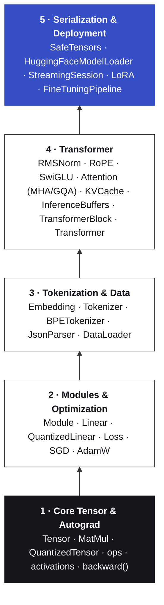

<p align="center">
  <picture>
    <source media="(prefers-color-scheme: dark)" srcset="assets/kotensor-logo-dark.png">
    
  </picture>
</p>

<p align="center">
  <b>Train, fine-tune and run Transformer language models in pure Kotlin — on the JVM and on Android.</b><br>
  Autograd, KV-cached decoding, INT8 / INT4 quantization, BPE tokenization, LoRA / QLoRA and Hugging Face checkpoint import — with no C++, Python or JNI dependencies.
</p>

<p align="center">
  
  
  
  
  
  
</p>

---

## What *is* Kotensor?

Kotensor is a lightweight, pure-Kotlin machine learning and generative Transformer engine for JVM and Android applications. It trains models with reverse-mode automatic differentiation, runs pre-trained Hugging Face checkpoints (Llama, Qwen 2, Mistral, SmolLM) with their own tokenizers, streams text through a KV-cached, allocation-free decoder, shrinks weights to INT8 or INT4, and fine-tunes on device with LoRA — all natively in Kotlin, without external C++, Python or JNI dependencies.

## Why Kotensor

Kotensor implements the whole stack — tensors, reverse-mode autograd, optimizers, a modern decoder-only Transformer, fast inference, quantization, tokenization, LoRA adapters and checkpoint I/O — in plain Kotlin. Its only runtime dependency is the Kotlin standard library (everything else comes from the JDK), so there is no JNI, no native runtime and no Python toolchain to ship, and one JAR serves servers, desktops and phones.

- **Trains, not just infers.** Every op records its backward pass; `backward()` runs reverse-mode autograd over the graph.
- **Modern Transformer blocks.** RMSNorm, rotary position embeddings (with Llama 3 scaling), SwiGLU feed-forward and causal multi-head or grouped-query attention in a pre-norm layout.
- **Fast autoregressive decoding.** A pre-allocated `KVCache` turns generation from re-running the whole sequence per token into a single-token step, and `Transformer.decode` runs that step with zero heap allocations.
- **Multi-core, vectorized matmul.** `MatMul` tiles the product for the cache, accumulates in a form HotSpot auto-vectorizes, and spreads tiles over a `ForkJoinPool` — still plain Kotlin.
- **Real vocabularies.** `BPETokenizer` loads Hugging Face `tokenizer.json` files (byte-level BPE: GPT-2, Qwen 2.5, SmolLM, Llama 3) with no JSON library, with `<|endoftext|>` / `<|im_start|>` / `<|im_end|>` support.
- **Runs Hugging Face checkpoints.** `HuggingFaceModelLoader.load(directory)` reads `config.json` and `.safetensors` shards (BF16/F16/F32) of Llama-, Qwen2- and Mistral-architecture models — grouped-query attention, tied embeddings and Llama 3 rope scaling included — into a Kotensor `Transformer`.
- **INT8 / INT4 on the edge.** Group-wise weight-only quantization with an on-the-fly dequantizing matmul: a 163M-parameter model drops from 652 MB to 173 MB (INT8) or 95 MB (INT4), saves to a compact file that loads without FP32 copies, and still trains LoRA adapters on top.
- **Parameter-efficient fine-tuning.** `LoRAAdapter` adds small low-rank matrices to the attention projections; train only those and the base weights stay untouched — FP32 or quantized (QLoRA).
- **Interoperable weights.** Reads `.safetensors` in F32, F16 and BF16 (including sharded checkpoints), writes F32 checkpoints and compact quantized model files.
- **Runs on Android.** Java 17 bytecode, Android 8.0+ (API 26), no native libraries; the `:sample-android` app streams, quantizes and fine-tunes on the phone.
- **Measured and documented.** A JMH suite for FLOP/s, tokens/s and allocations, Dokka API pages, and a Maven Central release pipeline.

## What's new since 0.1.0

| Version | Highlights |
| :-- | :-- |
| 0.2.0 | KV cache with prefill/decode generation and stop tokens; byte-level BPE tokenizer for Hugging Face `tokenizer.json`; incremental UTF-8-safe streaming; rotary-embedding position fix |
| 0.3.0 | Tiled, auto-vectorized, multi-threaded matmul (10–175× the throughput of the naive loop, depending on shape); allocation-free decode step; 3–4× faster generation |
| 0.4.0 | Grouped-/multi-query attention; Llama 3 rope scaling; streaming F16/BF16 `.safetensors` reader; Hugging Face config + weight importer |
| 0.5.0 | INT8 / INT4 group-wise quantization with a dequantizing matmul; QLoRA; compact model files; lazily allocated gradients |
| 1.0.0 | Android-ready Java 17 build; Compose sample app; Dokka docs; Maven Central publishing; JMH benchmarks; CI workflows |

[`CHANGELOG.md`](Engine/kotensor/CHANGELOG.md) explains each change, why it was needed and how it was verified.

## Contents

- [What *is* Kotensor?](#what-is-kotensor)
- [Why Kotensor](#why-kotensor)
- [What's new since 0.1.0](#whats-new-since-010)
- [Installation](#installation)
- [Quick start](#quick-start)
- [Usage guide](#usage-guide)
- [API overview](#api-overview)
- [Current limitations](#current-limitations)
- [Architecture](#architecture)
- [Building from source](#building-from-source)
- [Testing](#testing)
- [Android sample](#android-sample)
- [Benchmarks](#benchmarks)
- [API documentation](#api-documentation)
- [Releasing to Maven Central](#releasing-to-maven-central)
- [Roadmap](#roadmap)
- [License](#license)

## Installation

> **Requirements:** Java 17 or newer. The library is compiled to Java 17 bytecode against the Java 17 API (it is built with a Java 21 toolchain), and its only runtime dependency is the Kotlin standard library.
> **Android:** API 26 (Android 8.0) and newer. There are no native libraries, so there is no ABI split; [`:sample-android`](#android-sample) is a working Compose app built on it.

The coordinates are `io.github.tspstudio:kotensor:1.0.0` on Maven Central, available once the first release has been published (see [Releasing to Maven Central](#releasing-to-maven-central)). Until then, use the local JAR or `publishToMavenLocal` below.

### Gradle (Kotlin DSL)

```kotlin
repositories {
    mavenCentral()
}

dependencies {
    implementation("io.github.tspstudio:kotensor:1.0.0")
}
```

### Maven

```xml
<dependency>
  <groupId>io.github.tspstudio</groupId>
  <artifactId>kotensor</artifactId>
  <version>1.0.0</version>
</dependency>
```

### Maven Local

```bash
./gradlew publishToMavenLocal      # Windows: gradlew.bat publishToMavenLocal
```

Then add `mavenLocal()` to the consuming project's repositories. No signing keys are needed for local publishing.

### Local JAR (before a release is published)

```bash
cd Engine/kotensor
./gradlew jar          # Windows: gradlew.bat jar
# → build/libs/kotensor-<version>.jar
```

```kotlin
dependencies {
    implementation(files("libs/kotensor-<version>.jar"))
}
```

All public types live in the `io.kotensor.core` package:

```kotlin
import io.kotensor.core.*
```

## Quick start

Run a pre-trained model downloaded from the Hugging Face Hub, quantized to INT8 while it loads:

```kotlin
import io.kotensor.core.*
import java.io.File

fun main() {
    val directory = File("SmolLM2-135M")   // config.json, model.safetensors, tokenizer.json
    val model = HuggingFaceModelLoader.load(directory, Quantization.INT8)
    val tokenizer = HuggingFaceModelLoader.loadTokenizer(directory)

    model.generateStream("The capital of Mexico is", tokenizer, maxTokens = 32, stopTokens = setOfNotNull(tokenizer.endOfTextId)) { piece ->
        print(piece)
    }
}
```

Or train a tiny character-level language model from scratch and generate text from it:

```kotlin
import io.kotensor.core.*

fun main() {
    val text = "hello hello hello "
    val tokenizer = SimpleTokenizer(text)

    val model = Transformer(
        vocabularySize = tokenizer.vocabularySize,
        dimension = 16,
        numLayers = 1,
        numHeads = 2,
    )
    val optimizer = AdamW(model.parameters(), learningRate = 0.05f)

    val encoded = tokenizer.encode(text)
    val inputs = encoded.sliceArray(0 until encoded.size - 1)
    val targets = encoded.sliceArray(1 until encoded.size)

    repeat(40) {
        val logits = model.forward(inputs)
        val loss = crossEntropyLoss(logits, targets)
        loss.backward()
        optimizer.step()
        optimizer.zeroGrad()
    }

    println(model.generate("h", tokenizer, maxTokens = 5))
}
```

## Usage guide

### Tensors and autograd

A `Tensor` holds a flat `FloatArray` in row-major order, its `shape`, and a `grad` array of the same size. The constructor checks that the data size equals the product of the shape.

```kotlin
val x = Tensor(floatArrayOf(1f, 2f, 3f, 4f), intArrayOf(2, 2))
val w = Tensor(floatArrayOf(0.5f, -1f, 2f, 0f), intArrayOf(2, 2))
val b = Tensor(floatArrayOf(0.1f, 0.2f), intArrayOf(1, 2))

val y = (x matmul w) + b      // a [1, n] tensor broadcasts across the rows of [m, n]
val z = (y * y) * 0.5f        // element-wise product, then scalar multiply

z.backward()                  // seeds z.grad with 1s and runs reverse-mode autograd
println(w.grad.contentToString())
```

| Operation | Notes |
| :-- | :-- |
| `a + b` | Same shape, or a `[1, n]` row broadcast over `[m, n]` (either side) |
| `a - b`, `a * b` | Element-wise; shapes must match exactly |
| `a * 0.5f` | Multiply by a `Float` scalar |
| `a matmul b` | Infix; 2-D only, `[m, k] × [k, n]`; tiled and multi-threaded (see below) |
| `a.transpose()` | 2-D only |
| `a.reshape(intArrayOf(...))` | Copies the data with a new shape |
| `a.relu()`, `a.gelu()`, `a.silu()` | GELU uses the tanh approximation |
| `a.backward()` | Fills `a.grad` with 1s, then back-propagates through the graph |

Gradients **accumulate**. Call `zeroGrad()` on your optimizer (or clear `grad` yourself) between steps. `grad` is allocated on first use, so a model that only runs inference holds one copy of its weights.

**In-place ops** write into tensors you already own, record no graph and allocate nothing — they are what the inference loop is built on:

| Operation | Notes |
| :-- | :-- |
| `a.matmulInto(b, out)` | `out = a × b`; `accumulate = true` adds to `out`, `scale` multiplies the product |
| `a.matmulDequant(q)`, `a.matmulDequantInto(q, out)` | `a × dequantize(q)` for a `QuantizedTensor`, with gradient to `a` only |
| `a.addInto(b, out)`, `a.addInPlace(b)` | Same shapes, or a `[1, n]` row in `b` broadcast over the rows of `a` |
| `a.mulInPlace(b)`, `a.siluInPlace()` | Element-wise, in place |
| `a.copyFrom(b)` | Copies `b`'s values into `a` |

**Matrix multiplication.** `matmul` (forward and backward) and `matmulInto` run on `MatMul.multiply`, which computes the product one `[32, 256]` tile of the result at a time, accumulating in per-thread scratch rows so the inner loop is the `y[j] += a · x[j]` form that HotSpot's C2 compiler auto-vectorizes, with four result rows updated per pass over a row of `b`. Tiles are distributed over a `ForkJoinPool` with one worker per CPU core once a product exceeds `MatMul.parallelThreshold` multiply-adds (default 2¹⁸; set it to `Long.MAX_VALUE` to stay single-threaded). Single-row products — every decode step — use a stripe schedule instead, where each thread streams through the weight matrix once and owns a contiguous range of output columns. On a 2-core AVX-512 machine this reaches ≈ 24 GFLOP/s per thread, compared with ≈ 0.2–2 GFLOP/s for a naive triple loop. `MatMul.multiplyQuantized` is the same design for INT8 / INT4 weights (see [Quantization](#quantization-int8--int4)).

### Modules

Subclass `Module` and implement `forward`; override `parameters()` so optimizers can find the trainable tensors. Any module can be called like a function.

```kotlin
class MLP(inSize: Int, hidden: Int, outSize: Int) : Module() {
    val fc1 = Linear(inSize, hidden)
    val fc2 = Linear(hidden, outSize)

    override fun forward(input: Tensor): Tensor = fc2(fc1(input).gelu())

    override fun parameters(): List<Tensor> = fc1.parameters() + fc2.parameters()
}
```

`Linear(inSize, outSize)` computes `input matmul weight + bias`, with `weight` shaped `[inSize, outSize]` and `bias` shaped `[1, outSize]`.

### A training loop

```kotlin
val model = Linear(1, 1)
val optimizer = SGD(model.parameters(), learningRate = 0.1f)

val x = Tensor(floatArrayOf(2f), intArrayOf(1, 1))
val target = Tensor(floatArrayOf(10f), intArrayOf(1, 1))

repeat(50) {
    val loss = mseLoss(model(x), target)
    loss.backward()
    optimizer.step()
    optimizer.zeroGrad()
}
```

Swap `SGD` for `AdamW` for decoupled weight decay:

```kotlin
val optimizer = AdamW(
    parameters = model.parameters(),
    learningRate = 1e-4f,   // default
    beta1 = 0.9f,           // default
    beta2 = 0.999f,         // default
    epsilon = 1e-8f,        // default
    weightDecay = 0.01f,    // default
)
```

### Tokenization and batching

`Tokenizer` is an interface (`vocabularySize`, `encode`, `decode`). `SimpleTokenizer` is a character-level implementation built from a reference text; characters not seen in that text encode as `0`.

`BPETokenizer` is a byte-level byte-pair-encoding tokenizer that loads Hugging Face `tokenizer.json` files directly — vocabulary, merge ranks, pre-tokenization regex, added/special tokens and the post-processing template — using the engine's own `JsonParser`, so there is still no third-party dependency. Raw UTF-8 bytes are mapped to the 256 byte characters before merging, which means any string tokenizes without out-of-vocabulary failures.

```kotlin
import java.io.File

val tokenizer = BPETokenizer.fromFile(File("tokenizer.json"))   // GPT-2, Qwen 2.5, SmolLM, Llama 3 ...

val ids = tokenizer.encode("<|im_start|>user\nHola<|im_end|>")  // special tokens encode as single ids
tokenizer.decode(ids)                                            // "<|im_start|>user\nHola<|im_end|>"
tokenizer.decode(ids, skipSpecialTokens = true)                  // "user\nHola"

tokenizer.endOfTextId   // id of <|endoftext|>, or null
tokenizer.imStartId     // id of <|im_start|>
tokenizer.imEndId       // id of <|im_end|>
tokenizer.tokenId("<|eot_id|>")   // any other special token
tokenizer.encode(text, addSpecialTokens = false)   // skip the template's prefix/suffix tokens (e.g. Llama 3's <|begin_of_text|>)
```

`vocabularySize` is the largest id plus one, so it can be used directly as the `Transformer`'s vocabulary size. A tokenizer can also be built in code from a `vocab` map and a `merges` list. SentencePiece-style files (`Metaspace` pre-tokenizer, `byte_fallback` with `<0xNN>` tokens — Llama 2, Mistral) are not supported.

`DataLoader` slices a token array into consecutive next-token batches. Each `nextBatch()` returns `(inputs, targets)` as tensors shaped `[batchSize, sequenceLength]`, with targets shifted one token ahead. `Transformer.forward` treats each row of that batch as its own sequence.

```kotlin
val loader = DataLoader(tokens = encoded, batchSize = 4, sequenceLength = 8)

while (loader.hasNext()) {
    val (x, y) = loader.nextBatch()
    val loss = crossEntropyLoss(model.forward(x), y)
    loss.backward()
    optimizer.step()
    optimizer.zeroGrad()
}
loader.reset()
```

### The Transformer

```kotlin
val model = Transformer(
    vocabularySize = 256,
    dimension = 64,
    numLayers = 4,
    numHeads = 4,
    hiddenDimension = 256,   // optional, defaults to 4 × dimension
)

val logits = model.forward(intArrayOf(1, 2, 3))   // one sequence → shape [3, vocabularySize]

// A 2-D tensor of token IDs is read as [batch, sequenceLength]; rows don't attend to each other.
val batch = Tensor(floatArrayOf(1f, 2f, 3f, 4f, 5f, 6f), intArrayOf(2, 3))
val batchLogits = model.forward(batch)              // shape [2 × 3, vocabularySize]
```

Each `TransformerBlock` is pre-norm: `x + Attention(RMSNorm(x))`, then `+ SwiGLU(RMSNorm(·))`. Attention is causal, with rotary embeddings applied to queries and keys.

Grouped-query attention (GQA) and multi-query attention (MQA) are selected with `numKeyValueHeads`; the remaining constructor parameters follow the Hugging Face `config.json` fields:

```kotlin
val model = Transformer(
    vocabularySize = 49152,
    dimension = 576,
    numLayers = 30,
    numHeads = 9,
    hiddenDimension = 1536,
    numKeyValueHeads = 3,        // 3 key/value heads shared by 9 query heads; defaults to numHeads
    normEps = 1e-5f,             // rms_norm_eps
    ropeTheta = 100000.0f,       // rope_theta
    ropeScaling = null,          // RoPEScaling(factor, lowFrequencyFactor, highFrequencyFactor, originalMaxPositionEmbeddings) for Llama 3
)
```

With fewer key/value heads, `wK` and `wV` project to `numKeyValueHeads × headDim`, and the KV cache shrinks by the same factor.

**Generation** (greedy — picks the highest-scoring token at each step):

```kotlin
val tokens: IntArray = model.generate(prompt = intArrayOf(1, 2), maxTokens = 32)
val text: String = model.generate("h", tokenizer, maxTokens = 32)

// Token-by-token
for (token in model.generateStream(intArrayOf(1, 2), maxTokens = 32)) { /* ... */ }
model.generateStream("h", tokenizer, maxTokens = 32) { piece -> print(piece) }

// Stop early on an end-of-text token (not emitted)
model.generate(prompt, maxTokens = 256, stopTokens = setOfNotNull(tokenizer.endOfTextId))
```

Generation runs through a **KV cache**: the prompt is prefilled in one pass, and every further step feeds back only the token just produced, attending to the cached keys and values. A step therefore costs O(position) instead of re-running the whole sequence, and the output is the same as the uncached forward pass. Those steps go through `decode`, which keeps every intermediate in a pre-allocated `InferenceBuffers` — no heap allocation per token, so the garbage collector stays idle while text streams. Text streaming decodes incrementally, so a character spread over several byte-level tokens is delivered once it is complete.

To drive the cache yourself (for example to keep a conversation's context between turns):

```kotlin
val cache = model.newCache(maxSequenceLength = 512)   // [layers, heads, 512, headDim] × keys and values
val buffers = model.newInferenceBuffers(maxSequenceLength = 512)

var logits = model.forward(promptTokens, cache)        // prefill; cache.length == promptTokens.size
logits = model.decode(nextToken, cache, buffers)       // one allocation-free step → buffers.logits, shaped [1, vocabularySize]
logits = model.forward(intArrayOf(nextToken), cache)   // the same step through the graph path (allocates)
cache.remaining                                        // positions left before it is full
cache.reset()                                          // start a new sequence
```

`forward(indices, cache)` and `decode` are inference-only: no gradient is recorded through the cache. `decode` returns `buffers.logits` itself, so read it before the next call.

### Saving and loading weights

```kotlin
import java.io.File

SafeTensors.save(File("model.safetensors"), model.namedParameters())

val restored = Transformer(vocabularySize = 256, dimension = 64, numLayers = 4, numHeads = 4)
restored.loadParameters(SafeTensors.load(File("model.safetensors")))
```

`loadParameters` copies every tensor whose name matches and skips names that are missing; sizes must match. Parameter names follow the pattern `embedding.weight`, `block.<n>.attention.wQ.weight`, `block.<n>.ffn.wGate.bias`, `finalNorm.weight`, `lmHead.weight`, and so on.

`SafeTensors.load` reads every tensor as F32 regardless of how it is stored (`F32`, `F16`, `BF16`, `F64` and integer dtypes are converted). To read selectively, or to avoid holding a whole checkpoint in memory, open the file instead:

```kotlin
SafeTensors.open(File("model.safetensors")).use { reader ->
    reader.names                              // tensor names in file order
    reader.entry("model.norm.weight").dtype   // "BF16"
    reader.entry("model.norm.weight").shape   // [576]
    reader.readInto("model.norm.weight", target.data)   // converts straight into an existing FloatArray
    reader.load("lm_head.weight")             // a new Tensor
}
```

### Loading Hugging Face models

A model directory as downloaded from the Hub — `config.json`, `model.safetensors` (or `model-0000x-of-0000y.safetensors` plus `model.safetensors.index.json`) and `tokenizer.json` — loads directly:

```kotlin
import java.io.File

val directory = File("SmolLM2-135M")
val model = HuggingFaceModelLoader.load(directory) { name -> println("loaded $name") }
val tokenizer = HuggingFaceModelLoader.loadTokenizer(directory)

val session = StreamingSession(model, tokenizer)
session.stream("The capital of Mexico is", maxTokens = 64, stopTokens = setOfNotNull(tokenizer.endOfTextId)) { state ->
    print(state.generatedText)
}
```

Supported `model_type`s are `llama` (Llama 2/3, SmolLM, TinyLlama), `qwen2` (Qwen 2 / 2.5) and `mistral`; they share the pre-norm RMSNorm / rotary / SwiGLU decoder that `Transformer` implements. The importer reads `hidden_size`, `num_hidden_layers`, `num_attention_heads`, `num_key_value_heads`, `intermediate_size`, `rms_norm_eps`, `rope_theta`, `vocab_size`, `tie_word_embeddings` and a `llama3` `rope_scaling`, builds the `Transformer`, then maps every tensor by name:

| Hugging Face | Kotensor |
| :-- | :-- |
| `model.embed_tokens.weight` | `embedding.weight` |
| `model.layers.{i}.input_layernorm.weight` | `block.{i}.norm1.weight` |
| `model.layers.{i}.self_attn.{q,k,v,o}_proj.{weight,bias}` | `block.{i}.attention.{wQ,wK,wV,wOut}.{weight,bias}` (weights transposed to `[in, out]`) |
| `model.layers.{i}.post_attention_layernorm.weight` | `block.{i}.norm2.weight` |
| `model.layers.{i}.mlp.{gate,up,down}_proj.weight` | `block.{i}.ffn.{wGate,wUp,wDown}.weight` (transposed) |
| `model.norm.weight` | `finalNorm.weight` |
| `lm_head.weight` (or the embedding when tied) | `lmHead.weight` (transposed) |

Missing biases stay zero (Llama has none; Qwen's q/k/v biases are loaded), tensors Kotensor has no place for (such as `rotary_emb.inv_freq`) are listed in the returned `ImportReport.ignored`, and a checkpoint missing any weight fails with the names. `HuggingFaceModelLoader.loadConfig`, `newModel`, `weightFiles` and `loadWeights` expose the individual steps.

Memory: the model plus one checkpoint tensor at a time while importing. A tied output head is stored as its own transposed copy, so SmolLM2-135M occupies ≈ 652 MB in FP32, ≈ 173 MB with `HuggingFaceModelLoader.load(directory, Quantization.INT8)` and ≈ 95 MB with `Quantization.INT4`. Gradient arrays are only allocated if you train.

### LoRA fine-tuning

`LoRAAdapter` wraps the query (`wQ`) and value (`wV`) projections of every attention block in a `LoRALinear`. Give the optimizer only the adapter's parameters, so the base weights are not updated.

```kotlin
val adapter = LoRAAdapter(model, rank = 4, alpha = 1.0f)          // defaults: rank 4, alpha 1.0
val optimizer = AdamW(adapter.parameters(), learningRate = 0.05f)
val pipeline = FineTuningPipeline(model, adapter, optimizer)

pipeline.train(loader, epochs = 10) { epoch, averageLoss ->
    println("epoch $epoch — loss $averageLoss")
}

pipeline.exportAdapter(File("adapter.safetensors"))   // saves only the low-rank A/B matrices
```

Later, on a model built with the same configuration:

```kotlin
val adapter = LoRAAdapter(model, rank = 4, alpha = 1.0f)
val pipeline = FineTuningPipeline(model, adapter, AdamW(adapter.parameters()))
pipeline.loadAdapter(File("adapter.safetensors"))
pipeline.mergeAdapter()   // folds scaling × (A · B) into the base weights and removes the LoRA wrappers
```

After merging, the model is a plain `Transformer` again — save it with `SafeTensors.save(file, model.namedParameters())` and load it without an adapter. Before merging, `namedParameters()` exports the base weights and `exportAdapter` exports the adapter separately.

`FineTuningPipeline.trainStep(input, target)` runs a single forward/backward/optimizer step and returns the loss if you want your own loop.

Adapters also attach to a quantized model (QLoRA): the frozen INT8/INT4 base stays compact, gradients flow through it to the adapters, and `exportAdapter` saves them as before. `mergeAdapter()` is refused on a quantized base, since there are no FP32 weights to fold into.

### Quantization (INT8 / INT4)

Weight-only quantization keeps activations in FP32 and dequantizes weights inside the matmul, one row segment at a time, so the full FP32 matrix never exists in memory:

```kotlin
val model = HuggingFaceModelLoader.load(directory)          // FP32
model.quantize(Quantization.INT8)                           // in place: every projection and the embedding table
model.weightBytes()                                         // bytes held by the weights

val compact = HuggingFaceModelLoader.load(directory, Quantization.INT4)   // quantize while importing
compact.saveQuantized(File("model-int4.safetensors"))
val onDevice = Transformer.loadQuantized(File("model-int4.safetensors"))  // never allocates FP32 weights
```

| | bytes per weight | scheme |
| :-- | :-- | :-- |
| FP32 | 4 | — |
| `Quantization.INT8` | 1 + 4 / groupSize | symmetric, `scale · q`, one scale per column per group of 64 rows |
| `Quantization.INT4` | 0.5 + 5 / groupSize | asymmetric, `scale · (q − zero)`, two columns per byte |

`Quantization(bits, groupSize)` picks the group size (smaller groups: more accurate, slightly larger). `QuantizedLinear` and `QuantizedEmbedding` behave like `Linear` / `Embedding` in every path — graph forward, cached forward, allocation-free `decode` — and `QuantizedTensor.quantize` / `dequantize` are available directly. A quantized model can't be trained (its weights are frozen) except through LoRA adapters.

Measured on a SmolLM2-135M-shaped model (163 M parameters, 2-core container): FP32 652 MB at 8.6 tokens/s, INT8 173 MB at 12.2 tokens/s, INT4 95 MB at 8.0 tokens/s. The INT4 kernel is compute-bound on unpacking nibbles, so it trades a little speed for a 7× smaller footprint.

### Streaming generation with telemetry

`StreamingSession` runs generation and reports a `GenerationState` after every token — ready to drive a UI. It has no UI-framework dependency.

```kotlin
val session = StreamingSession(model, tokenizer)

val finalState = session.stream(prompt = "h", maxTokens = 64) { state ->
    // state.prompt, state.generatedText, state.isGenerating,
    // state.tokensGenerated, state.tokensPerSecond
}

session.cancel()   // safe to call from another thread; stops before the next token
```

`stream()` is synchronous: it returns the final state once generation finishes or is cancelled. Pass `stopTokens = setOfNotNull(tokenizer.endOfTextId)` to end a reply at the model's end-of-text token.

## API overview

| Area | Type / function | Purpose |
| :-- | :-- | :-- |
| Core | `Tensor` | Data, shape, lazily allocated gradient, ops, in-place ops and `backward()` |
| | `MatMul` | Tiled / striped, auto-vectorized, multi-threaded FP32 and dequantizing matmul kernels, transpose |
| | `Quantization`, `QuantizedTensor` | INT8 / INT4 group-wise weight quantization |
| | `Module` | Base class: `forward`, `parameters`, `invoke` |
| Layers | `Projection`, `Linear`, `QuantizedLinear` | Affine layers, FP32 or quantized; `forwardInto` |
| | `TokenEmbedding`, `Embedding`, `QuantizedEmbedding` | Token-index lookup tables; `lookupInto` |
| | `RMSNorm` | Root-mean-square normalization with a learned scale; `forwardInto` |
| | `RoPE`, `RoPEScaling` | Rotary position embeddings (`apply(input, startPosition)`), per head, with optional Llama 3 frequency scaling; `applyInPlace` |
| | `SwiGLU` | Gated feed-forward network (`wGate`, `wUp`, `wDown`); `forwardInto` |
| | `Attention` | Causal multi-head / grouped-query self-attention: full-sequence, cached, or allocation-free `decodeInto` |
| | `TransformerBlock` | Pre-norm attention + SwiGLU block; `decodeInto` |
| | `Transformer` | Decoder-only model: forward, cached generation, `decode`, named weights, `quantize`, `saveQuantized` / `loadQuantized` |
| | `KVCache` | Pre-allocated `[layers, heads, maxSequenceLength, headDim]` key/value buffers |
| | `InferenceBuffers` | Pre-allocated activations for `decode` |
| Losses | `mseLoss(prediction, target)` | Mean squared error |
| | `crossEntropyLoss(logits, targets)` | Softmax cross-entropy; targets as `IntArray` or `Tensor` |
| Optimizers | `SGD` | Plain gradient descent |
| | `AdamW` | Adam with decoupled weight decay |
| Data | `Tokenizer`, `SimpleTokenizer` | Text ↔ token IDs (character-level implementation) |
| | `BPETokenizer` | Byte-level BPE from Hugging Face `tokenizer.json`, special tokens |
| | `IncrementalDecoder` | Streams decoded text, holding back incomplete multi-byte characters |
| | `DataLoader` | Sequential next-token batches |
| I/O | `SafeTensors`, `SafeTensorsFile`, `SafeTensorsEntry` | `save` / `saveEntries` (any dtype, metadata) / `load` / `open` with per-tensor and raw reads, F16 / BF16 / F64 conversion |
| | `HuggingFaceModelLoader`, `HuggingFaceConfig`, `ImportReport` | `config.json` + `.safetensors` (sharded) importer for Llama / Qwen2 / Mistral checkpoints |
| | `JsonParser` | Minimal zero-dependency JSON reader (`parse(text)`) |
| Fine-tuning | `LoRALinear`, `LoRAAdapter` | Low-rank adapters on attention `wQ` / `wV` |
| | `FineTuningPipeline` | Training loop, adapter export/import, merge |
| Deployment | `StreamingSession`, `GenerationState` | Token streaming with cancellation and tokens/sec |

Generated API documentation: see [API documentation](#api-documentation).

## Current limitations

These describe the current code, so you can plan around them:

- **Precision and device:** `Float` (F32) only, on the CPU. Matrix multiplication is tiled, auto-vectorized by the JIT and multi-threaded; attention, normalization and the element-wise ops are plain single-threaded loops.
- **Shapes:** `matmul` and `transpose` take 2-D tensors. `+` broadcasts only a `[1, n]` row; `-` and `*` need identical shapes.
- **Batching:** sequences in a batch must all have the same length (there is no padding mask), and attention memory grows with `(batch × sequenceLength)²`.
- **Generation:** greedy decoding only (no temperature or sampling). The KV cache is F32 and sized up front (`2 × layers × heads × maxSequenceLength × headDim` floats); `forward(indices, cache)` and `decode` record no gradient. `decode` itself allocates nothing; a multi-threaded matmul inside it creates a few fork/join task objects per call, and the `Sequence` returned by `generateStream` boxes each yielded id.
- **Memory:** gradient arrays appear on first use (training doubles the FP32 weight footprint), and the matmul backward pass allocates transposed copies of its inputs.
- **Tokenizer:** byte-level BPE only; SentencePiece-style `tokenizer.json` files (`Metaspace`, `byte_fallback`) are not supported. Of the pre-tokenizers, `Split` and `ByteLevel` are applied and others (such as `Digits`) are skipped, and added tokens' `lstrip` / `rstrip` / `single_word` flags are ignored.
- **Importer:** `model_type` llama / qwen2 / mistral only (Gemma's `1 + w` norms, Phi-3's fused QKV and Qwen3's q/k norms are rejected), `rope_scaling` only of type `llama3`, `head_dim` must equal `hidden_size / num_attention_heads`.
- **Quantization:** weight-only (activations and the KV cache stay FP32), round-to-nearest with per-group min/max — no calibration or GPTQ/AWQ-style error correction; pre-quantized GGUF / AWQ files are not read. Norm weights and biases stay FP32.
- **LoRA scope:** adapters cover attention `wQ` and `wV` only.
- **SafeTensors:** writes F32 only; reads convert every dtype to F32.
- **Android performance:** the kernels were tuned and measured on HotSpot (desktop and server JVMs). ART compiles the same code with a different optimizer, so throughput on phones has to be measured there; the sample app shows live tokens/s for that reason.

## Architecture

Kotensor is 27 source files in five layers. Each layer builds only on the ones beneath it.



```text
Kotensor/
├── .github/workflows/            # ci.yml · docs.yml · release.yml
├── assets/                       # logos and app icon
└── Engine/kotensor/              # Gradle project (rootProject.name = "kotensor")
    ├── build.gradle.kts          # library: Kotlin/JVM, Dokka, Maven Central publishing
    ├── settings.gradle.kts       # :benchmark, and :sample-android with -Pkotensor.android=true
    ├── gradle.properties
    ├── gradlew / gradlew.bat     # Gradle 9.2.1 wrapper
    ├── Module.md                 # module overview rendered by Dokka
    ├── Milestone.md  CHANGELOG.md
    ├── benchmark/                # JMH suite (src/jmh/kotlin)
    ├── sample-android/           # Jetpack Compose demo app
    └── src/
        ├── main/kotlin/          # package io.kotensor.core
        │   ├── Tensor.kt  MatMul.kt  QuantizedTensor.kt  Module.kt  Linear.kt  QuantizedLinear.kt  Loss.kt  SGD.kt  AdamW.kt
        │   ├── Embedding.kt  Tokenizer.kt  BPETokenizer.kt  JsonParser.kt  DataLoader.kt
        │   ├── RMSNorm.kt  RoPE.kt  SwiGLU.kt  Attention.kt  KVCache.kt  InferenceBuffers.kt
        │   ├── TransformerBlock.kt  Transformer.kt
        │   └── SafeTensors.kt  HuggingFaceModelLoader.kt  StreamingSession.kt  LoRA.kt  FineTuningPipeline.kt
        └── test/
            ├── kotlin/
            │   ├── CoreTensorTest.kt
            │   ├── MatMulTest.kt
            │   ├── TransformerTest.kt
            │   ├── Phase5Test.kt
            │   ├── RegressionTest.kt
            │   ├── KVCacheTest.kt
            │   ├── InferenceTest.kt
            │   ├── GQATest.kt
            │   ├── HuggingFaceImportTest.kt
            │   ├── QuantizationTest.kt
            │   └── BPETokenizerTest.kt
            └── resources/        # reference tokenizer.json files + encodings from Hugging Face `tokenizers`;
                                  # hf/: tiny Llama/Qwen-style checkpoints with NumPy reference logits
```

## Building from source

**Toolchain:** Kotlin 2.3.20 · Gradle 9.2.1 (wrapper included) · Java 21 toolchain emitting Java 17 bytecode. The Foojay toolchain resolver is configured, so Gradle can download a matching JDK if none is installed.

```bash
git clone https://github.com/TSPstudio/kotensor.git
cd kotensor/Engine/kotensor
./gradlew build                                            # Windows: gradlew.bat build
./gradlew dokkaGenerate                                    # API docs → build/dokka/html
./gradlew :benchmark:jmh                                   # JMH suite
./gradlew -Pkotensor.android=true :sample-android:installDebug   # Android sample on a device
```

| Plugin | Version | Why this version |
| :-- | :-- | :-- |
| Kotlin JVM | 2.3.20 | Unchanged project baseline |
| Dokka | 2.2.0 | Latest stable; Dokka Gradle plugin v2 and K2 analysis by default |
| `com.vanniktech.maven.publish` | 0.37.0 | Central Portal publishing; requires Gradle ≥ 9.0 and Kotlin ≥ 2.2 |
| `me.champeau.jmh` | 0.7.3 | Latest release of the standard JMH Gradle plugin |
| Android Gradle plugin | 9.0.1 | Newest AGP that supports Gradle 9.2.1 (AGP 9.1 needs Gradle 9.3.1, 9.2 needs 9.4.1) |

## Testing

```bash
./gradlew test
```

66 tests across eleven suites, run on the JUnit Platform with `kotlin-test`:

| Suite | Tests |
| :-- | :-- |
| `CoreTensorTest` (4) | Transpose & reshape · activations · arithmetic & broadcasting · `Linear` + `SGD` convergence |
| `MatMulTest` (5) | Tiled kernel vs naive on odd shapes (incl. accumulate/scale) · parallel vs serial · transpose · `matmul` backward vs naive gradients · in-place ops |
| `TransformerTest` (3) | Block forward/backward · cross-entropy · end-to-end training and generation |
| `Phase5Test` (5) | SafeTensors save/load · model weight persistence · LoRA fine-tuning · streaming & cancellation · fine-tuning pipeline |
| `RegressionTest` (4) | Batched sequences match single-sequence output · LoRA merge applies the delta once · RoPE rotates every head by the token position · weight export with LoRA attached |
| `KVCacheTest` (8) | Buffer layout · cached decode matches the full forward (plain and with LoRA) · `generate` matches uncached greedy decoding · stop tokens · capacity checks · reset · streaming text |
| `InferenceTest` (5) | `decode` matches the graph forward (plain and with LoRA) · in-place modules match their graph versions · a decode step allocates 0 bytes (`ThreadMXBean`) · cache/buffer checks |
| `GQATest` (6) | Grouped-query output equals multi-head with replicated K/V · gradients sum over the group · cached and decode paths with grouped heads · training · invalid groupings · rope theta and Llama 3 scaling |
| `HuggingFaceImportTest` (7) | Llama-style BF16 checkpoint matches a NumPy reference (forward and decode) · sharded Qwen-style F16/F32/BF16 with biases, MQA and tied embeddings · Llama 3 rope scaling · name mapping · config validation · missing weights · F16/BF16/F32 reading |
| `QuantizationTest` (11) | Quantize/dequantize error bounds · dequantizing matmul vs dequantized FP32 (forward, accumulate, backward) · parallel vs serial · `matmulDequant` gradients · INT8/INT4 model within tolerance in full, cached, decode and batched paths · allocation-free quantized decode · QLoRA trains and decodes · quantized save/load round trip · quantized import equals quantize-after-import · bytes per weight · lazy gradients |
| `BPETokenizerTest` (8) | Encodings and decodings identical to Hugging Face `tokenizers` on GPT-2-, Qwen- and Llama-3-style files · byte-level round trip of arbitrary text · special tokens · template tokens · in-code construction · incremental decoding · pre-tokenizer regex compilation (Android-safe flags) · JSON parser |

## Android sample

`:sample-android` is a Jetpack Compose app that runs the engine entirely on the phone:

- **Live token streaming** — type a prompt and watch text arrive token by token, with tokens/s, through `StreamingSession` (KV-cached, allocation-free decode). Stop cancels mid-stream.
- **Memory telemetry** — Java heap used / max, native heap, bytes held by the weights, and the KV-cache size for 2,048 positions, refreshed every second.
- **On-device training** — with no model installed, the app trains a small character-level Transformer at start-up and plots the loss; you can then attach a LoRA adapter and fine-tune it on any text you type, again with a live loss curve.
- **Quantization** — one tap quantizes the loaded model to INT8 or INT4 in place; fine-tuning then becomes QLoRA on the compact weights.
- **Real models** — copy a Hugging Face model directory (`config.json`, `model.safetensors`, `tokenizer.json`) into the app's `files/model` directory and reload; it is imported as INT8. A `kotensor-quantized.safetensors` written by `saveQuantized`, next to its `tokenizer.json`, loads directly.

```bash
./gradlew -Pkotensor.android=true :sample-android:installDebug
adb push SmolLM2-135M /data/local/tmp/model
adb shell run-as io.kotensor.sample cp -r /data/local/tmp/model files/
```

The module is only included when the `kotensor.android` property is `true`, so the library build and `./gradlew test` never need an Android SDK. Pass `-Pkotensor.android=true`, or add `kotensor.android=true` to `~/.gradle/gradle.properties` so Android Studio always shows the module. It needs an Android SDK with platform 36; it uses AGP 9.0.1 with built-in Kotlin, the Compose compiler plugin, `minSdk` 26 and `compileSdk` / `targetSdk` 36.

## Benchmarks

`benchmark/` is a [JMH](https://github.com/openjdk/jmh) suite run through the `me.champeau.jmh` plugin:

```bash
./gradlew :benchmark:jmh                       # everything; JSON results in benchmark/build/results/jmh/results.json
./gradlew :benchmark:jmhJar
java -jar benchmark/build/libs/benchmark-1.0.0-jmh.jar DecodeBenchmark -p weights=int4 -p sequenceLength=512
```

| Benchmark | Measures |
| :-- | :-- |
| `MatMulBenchmark` | FLOP/s (operations are floating-point operations): 512³ FP32 matmul, a 32-row prefill-shaped product, and the 2048 × 8192 decode matvec in FP32, INT8 and INT4 |
| `DecodeBenchmark` | Tokens/s of one allocation-free decode step on a SmolLM2-135M-shaped model (30 layers, dim 576, GQA 9/3, vocab 49,152) at KV-cache lengths 16 / 128 / 512 / 2,048, for FP32, INT8 and INT4 weights |
| `GenerateBenchmark` | End-to-end tokens/s of `generate` and of text streaming through `StreamingSession`, and prompt prefill latency, on a small model |
| `TrainingBenchmark` | Milliseconds per full fine-tuning step (AdamW on every weight) and per QLoRA step (rank-8 adapters on an INT8 base) |
| `TokenizerBenchmark` | BPE encode and decode throughput on mixed-language text |

Every run uses the `gc` profiler, so the results include `gc.alloc.rate.norm` — bytes allocated per operation — next to the throughput.

## API documentation

```bash
./gradlew dokkaGenerate        # → build/dokka/html/index.html
```

Dokka 2 renders every public declaration of `io.kotensor.core`, with links to the source on GitHub and the overview in [`Module.md`](Engine/kotensor/Module.md). The source code follows a no-comments style, so the pages document signatures, types and that overview rather than per-function prose; this README is the narrative guide. `.github/workflows/docs.yml` publishes the HTML to GitHub Pages on every push to `main`.

## Releasing to Maven Central

Publishing uses the [Central Portal](https://central.sonatype.com) through `com.vanniktech.maven.publish`, with GPG signatures and MD5 / SHA-1 / SHA-256 / SHA-512 checksums for every artifact (`mavenCentralChecksums` in `gradle.properties`). The javadoc JAR contains the Dokka HTML.

1. Sign up for the Central Portal with the `TSPstudio` GitHub account; the portal then creates and verifies the `io.github.tspstudio` namespace automatically. An account created any other way adds the namespace under **Namespaces** and verifies it with a temporary public repository on that GitHub account, named after the verification key the portal shows. `group` and `coordinates` in `build.gradle.kts` must match the verified namespace exactly.
2. Create a GPG key and upload its public half to a key server (for example `keyserver.ubuntu.com`).
3. Add the repository secrets `MAVEN_CENTRAL_USERNAME` and `MAVEN_CENTRAL_PASSWORD` (a Central Portal user token), `SIGNING_KEY` (the ASCII-armored private key), `SIGNING_KEY_ID` and `SIGNING_KEY_PASSWORD`.
4. Push a tag such as `v1.0.0`. `.github/workflows/release.yml` runs the tests, signs and uploads the publication, releases it, and attaches the JARs with a `SHA256SUMS` file to the GitHub release.

Signing is switched on only by `-PsignAllPublications=true` in that workflow, so local `publishToMavenLocal` builds need no keys.

## Roadmap

The five planned layers are implemented, and so are all five milestones of [`Milestone.md`](Milestone.md): v0.2.0 KV-cached decoding and the BPE tokenizer; v0.3.0 tiled multi-threaded matmul and the zero-allocation decode loop; v0.4.0 grouped-query attention and the Hugging Face importer; v0.5.0 INT8 / INT4 quantization; v1.0.0 the Android sample, Dokka documentation, Maven Central publishing and the JMH suite. [`CHANGELOG.md`](Engine/kotensor/CHANGELOG.md) explains every change since v0.1.0 and why it was made.

<details>
<summary><b>Layer 1 — Core Tensor & Autograd</b> ✅</summary>

- [x] Shape-checked `Tensor` with data, shape and gradient
- [x] Forward and backward ops: `plus` (with row broadcasting), `minus`, `times`, scalar `times`, `matmul`, `transpose`, `reshape`
- [x] Topological sort and reverse-mode autograd (`backward()`)
- [x] Activations `relu`, `gelu`, `silu`
</details>

<details>
<summary><b>Layer 2 — Modules & Optimization</b> ✅</summary>

- [x] `Module` base with `parameters()` — `Module.kt`
- [x] `Linear` with Xavier-style initialization — `Linear.kt`
- [x] `mseLoss` and `crossEntropyLoss` — `Loss.kt`
- [x] `SGD` and `AdamW` — `SGD.kt`, `AdamW.kt`
</details>

<details>
<summary><b>Layer 3 — Tokenization & Data</b> ✅</summary>

- [x] Embedding lookup table — `Embedding.kt`
- [x] `Tokenizer` interface and character-level `SimpleTokenizer` — `Tokenizer.kt`
- [x] Next-token batching `DataLoader` — `DataLoader.kt`
</details>

<details>
<summary><b>Layer 4 — Transformer Architecture</b> ✅</summary>

- [x] `RMSNorm` — `RMSNorm.kt`
- [x] Rotary positional embeddings — `RoPE.kt`
- [x] SwiGLU feed-forward network — `SwiGLU.kt`
- [x] Causal multi-head attention — `Attention.kt`
- [x] Pre-norm Transformer block — `TransformerBlock.kt`
- [x] Decoder-only model with greedy and streaming generation — `Transformer.kt`
</details>

<details>
<summary><b>Layer 5 — Serialization & Deployment</b> ✅</summary>

- [x] `.safetensors` reader/writer — `SafeTensors.kt`
- [x] Streaming generation session with telemetry and cancellation — `StreamingSession.kt`
- [x] LoRA adapters and fine-tuning pipeline — `LoRA.kt`, `FineTuningPipeline.kt`
</details>

<details>
<summary><b>v0.2.0 — Autoregressive Inference & Subword Tokenization</b> ✅</summary>

- [x] Pre-allocated `KVCache` and cached decode path through `Attention`, `TransformerBlock` and `Transformer` — `KVCache.kt`
- [x] `generate` / `generateStream` / `StreamingSession` prefill once and decode one token per step, with optional stop tokens
- [x] Byte-level `BPETokenizer` loading Hugging Face `tokenizer.json` with the zero-dependency `JsonParser` — `BPETokenizer.kt`, `JsonParser.kt`
- [x] Special tokens (`<|endoftext|>`, `<|im_start|>`, `<|im_end|>`, template tokens) and `IncrementalDecoder` for byte-safe streaming
</details>

<details>
<summary><b>v0.3.0 — Compute Performance & Memory Efficiency</b> ✅</summary>

- [x] Tiled, auto-vectorized, `ForkJoinPool`-parallel matmul kernel behind `Tensor.matmul` (forward and backward) — `MatMul.kt`
- [x] In-place tensor ops `matmulInto`, `addInto` / `addInPlace`, `mulInPlace`, `siluInPlace`, `copyFrom` — `Tensor.kt`
- [x] `InferenceBuffers` and the allocation-free `Transformer.decode` step (`forwardInto` / `decodeInto` / `applyInPlace` / `lookupInto` through every module) — `InferenceBuffers.kt`
- [x] `generateStream` and `StreamingSession` decode through the buffers after a single prefill
</details>

<details>
<summary><b>v0.4.0 — Architecture Generalization & Model Importers</b> ✅</summary>

- [x] Grouped-query / multi-query attention (`numKeyValueHeads`) in every attention path, with the KV cache sized to the key/value heads — `Attention.kt`
- [x] `normEps`, `ropeTheta` and Llama 3 `RoPEScaling` through `Transformer` / `TransformerBlock` / `RoPE` — `RoPE.kt`
- [x] Per-tensor `SafeTensorsFile` reader with F16 / BF16 / F64 / integer conversion — `SafeTensors.kt`
- [x] `HuggingFaceModelLoader`: `config.json`, declarative weight-name mapping, transposed linears, shards, tied embeddings, import report — `HuggingFaceModelLoader.kt`
</details>

<details>
<summary><b>v0.5.0 — Edge Quantization (INT8 / INT4)</b> ✅</summary>

- [x] `QuantizedTensor` with group-wise INT8 (symmetric) and INT4 (zero-point, two columns per byte) — `QuantizedTensor.kt`
- [x] Dequantizing matmul kernels (`multiplyQuantized`, `multiplyByQuantizedTransposed`), stripe schedule for decode — `MatMul.kt`
- [x] `QuantizedLinear` / `QuantizedEmbedding`, `Transformer.quantize`, construction with `quantization`, QLoRA over quantized bases — `QuantizedLinear.kt`, `Embedding.kt`, `LoRA.kt`
- [x] Compact `saveQuantized` / `loadQuantized` and quantized Hugging Face import; lazily allocated gradients — `Transformer.kt`, `SafeTensors.kt`, `HuggingFaceModelLoader.kt`, `Tensor.kt`
</details>

<details>
<summary><b>v1.0.0 — Production Hardening & Ecosystem Integration</b> ✅</summary>

- [x] Java 17 bytecode against the Java 17 API; Android-safe regex flags in `BPETokenizer` — `build.gradle.kts`, `BPETokenizer.kt`
- [x] `:sample-android` Compose app: streaming, memory telemetry, on-device training, LoRA / QLoRA, quantization — `sample-android/`
- [x] Dokka 2 HTML documentation with `Module.md`, published by GitHub Pages — `build.gradle.kts`, `.github/workflows/docs.yml`
- [x] Maven Central release of `io.github.tspstudio:kotensor` with GPG signing and SHA-256 / SHA-512 checksums — `build.gradle.kts`, `.github/workflows/release.yml`
- [x] JMH benchmark suite for FLOP/s, tokens/s across sequence lengths, training steps and allocations — `benchmark/`
</details>

## License

Apache License 2.0 — see [`LICENSE`](LICENSE).

Anyone who redistributes Kotensor or a work built on it — in source form, as a modified copy, or bundled inside an application or library — must keep the license and copyright notice and include the attribution in [`NOTICE`](NOTICE). The published JAR carries both files in `META-INF`.

<p align="center">
  <sub>Built in Kotlin, from the tensor up.</sub>
</p>
