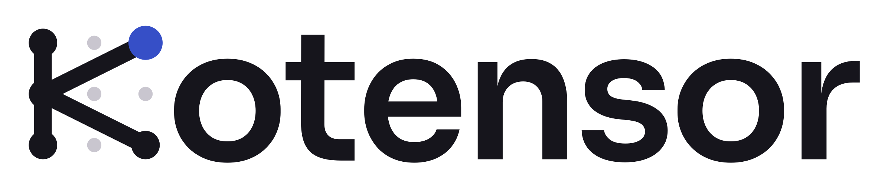
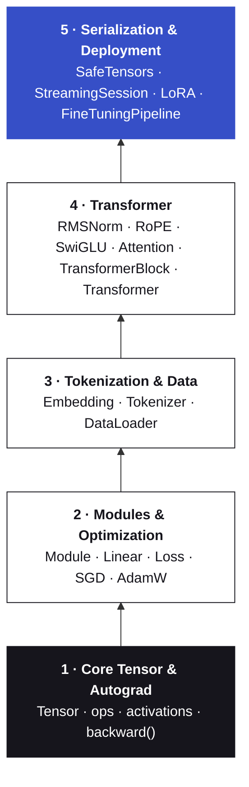

<p align="center">
  <picture>
    <source media="(prefers-color-scheme: dark)" srcset="assets/kotensor-logo-dark.png">
    
  </picture>
</p>

<p align="center">
  <b>Automatic differentiation and Transformer training in pure Kotlin.</b><br>
  Tensors, autograd, a decoder-only Transformer, LoRA fine-tuning and <code>.safetensors</code> I/O — with no C++ or Python dependencies.
</p>

<p align="center">
  
  
  
  
  
</p>

---

## Why Kotensor

Kotensor implements the full training loop — tensors, reverse-mode autograd, optimizers, a modern decoder-only Transformer, LoRA adapters and `.safetensors` serialization — in plain Kotlin. Its only runtime dependency is the Kotlin standard library (plus `java.io` / `java.nio` for file I/O), so there is no JNI, no native runtime and no Python toolchain to ship.

- **Trains, not just infers.** Every op records its backward pass; `backward()` runs reverse-mode autograd over the graph.
- **Modern Transformer blocks.** RMSNorm, rotary position embeddings, SwiGLU feed-forward and causal multi-head attention in a pre-norm layout.
- **Parameter-efficient fine-tuning.** `LoRAAdapter` adds small low-rank matrices to the attention projections; train only those and the base weights stay untouched.
- **Interoperable weights.** Saves and loads F32 tensors in the `.safetensors` format.

## Contents

- [Installation](#installation)
- [Quick start](#quick-start)
- [Usage guide](#usage-guide)
- [API overview](#api-overview)
- [Current limitations](#current-limitations)
- [Architecture](#architecture)
- [Building from source](#building-from-source)
- [Testing](#testing)
- [Roadmap](#roadmap)
- [Contributing](#contributing)
- [License](#license)

## Installation

> **Requirements:** a JVM project with a Java 21 toolchain. Kotensor is currently built with the Kotlin JVM plugin (`kotlin("jvm")`) and `jvmToolchain(21)`.
> **Android:** [PLACEHOLDER: state whether Android is supported, and the minimum SDK / Java bytecode level, once verified]

### Gradle (Kotlin DSL)

```kotlin
repositories {
    [PLACEHOLDER: REPOSITORY WHERE KOTENSOR IS PUBLISHED]
}

dependencies {
    implementation("[PLACEHOLDER: GROUP_ID]:kotensor:[PLACEHOLDER: VERSION]")
}
```

### Maven

```xml
<dependency>
  <groupId>[PLACEHOLDER: GROUP_ID]</groupId>
  <artifactId>kotensor</artifactId>
  <version>[PLACEHOLDER: VERSION]</version>
</dependency>
```

### Local JAR (before a release is published)

```bash
cd Engine/kotensor
./gradlew jar          # Windows: gradlew.bat jar
# → build/libs/kotensor-<version>.jar
```

```kotlin
dependencies {
    implementation(files("libs/kotensor-<version>.jar"))
}
```

All public types live in the `io.kotensor.core` package:

```kotlin
import io.kotensor.core.*
```

## Quick start

Train a tiny character-level language model and generate text from it:

```kotlin
import io.kotensor.core.*

fun main() {
    val text = "hello hello hello "
    val tokenizer = SimpleTokenizer(text)

    val model = Transformer(
        vocabularySize = tokenizer.vocabularySize,
        dimension = 16,
        numLayers = 1,
        numHeads = 2,
    )
    val optimizer = AdamW(model.parameters(), learningRate = 0.05f)

    val encoded = tokenizer.encode(text)
    val inputs = encoded.sliceArray(0 until encoded.size - 1)
    val targets = encoded.sliceArray(1 until encoded.size)

    repeat(40) {
        val logits = model.forward(inputs)
        val loss = crossEntropyLoss(logits, targets)
        loss.backward()
        optimizer.step()
        optimizer.zeroGrad()
    }

    println(model.generate("h", tokenizer, maxTokens = 5))
}
```

## Usage guide

### Tensors and autograd

A `Tensor` holds a flat `FloatArray` in row-major order, its `shape`, and a `grad` array of the same size. The constructor checks that the data size equals the product of the shape.

```kotlin
val x = Tensor(floatArrayOf(1f, 2f, 3f, 4f), intArrayOf(2, 2))
val w = Tensor(floatArrayOf(0.5f, -1f, 2f, 0f), intArrayOf(2, 2))
val b = Tensor(floatArrayOf(0.1f, 0.2f), intArrayOf(1, 2))

val y = (x matmul w) + b      // a [1, n] tensor broadcasts across the rows of [m, n]
val z = (y * y) * 0.5f        // element-wise product, then scalar multiply

z.backward()                  // seeds z.grad with 1s and runs reverse-mode autograd
println(w.grad.contentToString())
```

| Operation | Notes |
| :-- | :-- |
| `a + b` | Same shape, or a `[1, n]` row broadcast over `[m, n]` (either side) |
| `a - b`, `a * b` | Element-wise; shapes must match exactly |
| `a * 0.5f` | Multiply by a `Float` scalar |
| `a matmul b` | Infix; 2-D only, `[m, k] × [k, n]` |
| `a.transpose()` | 2-D only |
| `a.reshape(intArrayOf(...))` | Copies the data with a new shape |
| `a.relu()`, `a.gelu()`, `a.silu()` | GELU uses the tanh approximation |
| `a.backward()` | Fills `a.grad` with 1s, then back-propagates through the graph |

Gradients **accumulate**. Call `zeroGrad()` on your optimizer (or clear `grad` yourself) between steps.

### Modules

Subclass `Module` and implement `forward`; override `parameters()` so optimizers can find the trainable tensors. Any module can be called like a function.

```kotlin
class MLP(inSize: Int, hidden: Int, outSize: Int) : Module() {
    val fc1 = Linear(inSize, hidden)
    val fc2 = Linear(hidden, outSize)

    override fun forward(input: Tensor): Tensor = fc2(fc1(input).gelu())

    override fun parameters(): List<Tensor> = fc1.parameters() + fc2.parameters()
}
```

`Linear(inSize, outSize)` computes `input matmul weight + bias`, with `weight` shaped `[inSize, outSize]` and `bias` shaped `[1, outSize]`.

### A training loop

```kotlin
val model = Linear(1, 1)
val optimizer = SGD(model.parameters(), learningRate = 0.1f)

val x = Tensor(floatArrayOf(2f), intArrayOf(1, 1))
val target = Tensor(floatArrayOf(10f), intArrayOf(1, 1))

repeat(50) {
    val loss = mseLoss(model(x), target)
    loss.backward()
    optimizer.step()
    optimizer.zeroGrad()
}
```

Swap `SGD` for `AdamW` for decoupled weight decay:

```kotlin
val optimizer = AdamW(
    parameters = model.parameters(),
    learningRate = 1e-4f,   // default
    beta1 = 0.9f,           // default
    beta2 = 0.999f,         // default
    epsilon = 1e-8f,        // default
    weightDecay = 0.01f,    // default
)
```

### Tokenization and batching

`Tokenizer` is an interface (`vocabularySize`, `encode`, `decode`). `SimpleTokenizer` is a character-level implementation built from a reference text; characters not seen in that text encode as `0`.

`DataLoader` slices a token array into consecutive next-token batches. Each `nextBatch()` returns `(inputs, targets)` as tensors shaped `[batchSize, sequenceLength]`, with targets shifted one token ahead. `Transformer.forward` treats each row of that batch as its own sequence.

```kotlin
val loader = DataLoader(tokens = encoded, batchSize = 4, sequenceLength = 8)

while (loader.hasNext()) {
    val (x, y) = loader.nextBatch()
    val loss = crossEntropyLoss(model.forward(x), y)
    loss.backward()
    optimizer.step()
    optimizer.zeroGrad()
}
loader.reset()
```

### The Transformer

```kotlin
val model = Transformer(
    vocabularySize = 256,
    dimension = 64,
    numLayers = 4,
    numHeads = 4,
    hiddenDimension = 256,   // optional, defaults to 4 × dimension
)

val logits = model.forward(intArrayOf(1, 2, 3))   // one sequence → shape [3, vocabularySize]

// A 2-D tensor of token IDs is read as [batch, sequenceLength]; rows don't attend to each other.
val batch = Tensor(floatArrayOf(1f, 2f, 3f, 4f, 5f, 6f), intArrayOf(2, 3))
val batchLogits = model.forward(batch)              // shape [2 × 3, vocabularySize]
```

Each `TransformerBlock` is pre-norm: `x + Attention(RMSNorm(x))`, then `+ SwiGLU(RMSNorm(·))`. Attention is causal, with rotary embeddings applied to queries and keys.

**Generation** (greedy — picks the highest-scoring token at each step):

```kotlin
val tokens: IntArray = model.generate(prompt = intArrayOf(1, 2), maxTokens = 32)
val text: String = model.generate("h", tokenizer, maxTokens = 32)

// Token-by-token
for (token in model.generateStream(intArrayOf(1, 2), maxTokens = 32)) { /* ... */ }
model.generateStream("h", tokenizer, maxTokens = 32) { piece -> print(piece) }
```

### Saving and loading weights

```kotlin
import java.io.File

SafeTensors.save(File("model.safetensors"), model.namedParameters())

val restored = Transformer(vocabularySize = 256, dimension = 64, numLayers = 4, numHeads = 4)
restored.loadParameters(SafeTensors.load(File("model.safetensors")))
```

`loadParameters` copies every tensor whose name matches and skips names that are missing; sizes must match. Parameter names follow the pattern `embedding.weight`, `block.<n>.attention.wQ.weight`, `block.<n>.ffn.wGate.bias`, `finalNorm.weight`, `lmHead.weight`, and so on.

### LoRA fine-tuning

`LoRAAdapter` wraps the query (`wQ`) and value (`wV`) projections of every attention block in a `LoRALinear`. Give the optimizer only the adapter's parameters, so the base weights are not updated.

```kotlin
val adapter = LoRAAdapter(model, rank = 4, alpha = 1.0f)          // defaults: rank 4, alpha 1.0
val optimizer = AdamW(adapter.parameters(), learningRate = 0.05f)
val pipeline = FineTuningPipeline(model, adapter, optimizer)

pipeline.train(loader, epochs = 10) { epoch, averageLoss ->
    println("epoch $epoch — loss $averageLoss")
}

pipeline.exportAdapter(File("adapter.safetensors"))   // saves only the low-rank A/B matrices
```

Later, on a model built with the same configuration:

```kotlin
val adapter = LoRAAdapter(model, rank = 4, alpha = 1.0f)
val pipeline = FineTuningPipeline(model, adapter, AdamW(adapter.parameters()))
pipeline.loadAdapter(File("adapter.safetensors"))
pipeline.mergeAdapter()   // folds scaling × (A · B) into the base weights and removes the LoRA wrappers
```

After merging, the model is a plain `Transformer` again — save it with `SafeTensors.save(file, model.namedParameters())` and load it without an adapter. Before merging, `namedParameters()` exports the base weights and `exportAdapter` exports the adapter separately.

`FineTuningPipeline.trainStep(input, target)` runs a single forward/backward/optimizer step and returns the loss if you want your own loop.

### Streaming generation with telemetry

`StreamingSession` runs generation and reports a `GenerationState` after every token — ready to drive a UI. It has no UI-framework dependency.

```kotlin
val session = StreamingSession(model, tokenizer)

val finalState = session.stream(prompt = "h", maxTokens = 64) { state ->
    // state.prompt, state.generatedText, state.isGenerating,
    // state.tokensGenerated, state.tokensPerSecond
}

session.cancel()   // safe to call from another thread; stops before the next token
```

`stream()` is synchronous: it returns the final state once generation finishes or is cancelled.

## API overview

| Area | Type / function | Purpose |
| :-- | :-- | :-- |
| Core | `Tensor` | Data, shape, gradient, ops and `backward()` |
| | `Module` | Base class: `forward`, `parameters`, `invoke` |
| Layers | `Linear` | Affine layer with Xavier-style scaled-uniform init |
| | `Embedding` | Token-index lookup table |
| | `RMSNorm` | Root-mean-square normalization with a learned scale |
| | `RoPE` | Rotary position embeddings (`apply(input, startPosition)`) |
| | `SwiGLU` | Gated feed-forward network (`wGate`, `wUp`, `wDown`) |
| | `Attention` | Causal multi-head self-attention |
| | `TransformerBlock` | Pre-norm attention + SwiGLU block |
| | `Transformer` | Decoder-only model: forward, generation, named weights |
| Losses | `mseLoss(prediction, target)` | Mean squared error |
| | `crossEntropyLoss(logits, targets)` | Softmax cross-entropy; targets as `IntArray` or `Tensor` |
| Optimizers | `SGD` | Plain gradient descent |
| | `AdamW` | Adam with decoupled weight decay |
| Data | `Tokenizer`, `SimpleTokenizer` | Text ↔ token IDs (character-level implementation) |
| | `DataLoader` | Sequential next-token batches |
| I/O | `SafeTensors` | `save(file, tensors)` / `load(file)` for F32 tensors |
| Fine-tuning | `LoRALinear`, `LoRAAdapter` | Low-rank adapters on attention `wQ` / `wV` |
| | `FineTuningPipeline` | Training loop, adapter export/import, merge |
| Deployment | `StreamingSession`, `GenerationState` | Token streaming with cancellation and tokens/sec |

[PLACEHOLDER: link to generated API documentation (e.g. Dokka), if published]

## Current limitations

These describe the current code, so you can plan around them:

- **Precision and device:** `Float` (F32) only, computed with plain loops on the CPU.
- **Shapes:** `matmul` and `transpose` take 2-D tensors. `+` broadcasts only a `[1, n]` row; `-` and `*` need identical shapes.
- **Batching:** sequences in a batch must all have the same length (there is no padding mask), and attention memory grows with `(batch × sequenceLength)²`.
- **Generation:** greedy decoding only (no temperature or sampling), and each new token re-runs the full sequence (no key/value cache).
- **LoRA scope:** adapters cover attention `wQ` and `wV` only.
- **SafeTensors:** writes F32; the loader reads every entry as F32 and loads the whole file into memory.

## Architecture

Kotensor is 19 source files in five layers. Each layer builds only on the ones beneath it.



```text
Kotensor/
├── assets/                       # logos and app icon
└── Engine/kotensor/              # Gradle project (rootProject.name = "kotensor")
    ├── build.gradle.kts
    ├── settings.gradle.kts
    ├── gradlew / gradlew.bat     # Gradle 9.2.1 wrapper
    └── src/
        ├── main/kotlin/          # package io.kotensor.core
        │   ├── Tensor.kt  Module.kt  Linear.kt  Loss.kt  SGD.kt  AdamW.kt
        │   ├── Embedding.kt  Tokenizer.kt  DataLoader.kt
        │   ├── RMSNorm.kt  RoPE.kt  SwiGLU.kt  Attention.kt
        │   ├── TransformerBlock.kt  Transformer.kt
        │   └── SafeTensors.kt  StreamingSession.kt  LoRA.kt  FineTuningPipeline.kt
        └── test/kotlin/
            ├── CoreTensorTest.kt
            ├── TransformerTest.kt
            ├── Phase5Test.kt
            └── RegressionTest.kt
```

## Building from source

**Toolchain:** Kotlin 2.3.20 · Gradle 9.2.1 (wrapper included) · Java 21 toolchain. The Foojay toolchain resolver is configured, so Gradle can download a matching JDK if none is installed.

```bash
git clone https://github.com/TSPstudio/kotensor.git
cd kotensor/Engine/kotensor
./gradlew build        # Windows: gradlew.bat build
```

## Testing

```bash
./gradlew test
```

15 tests across four suites, run on the JUnit Platform with `kotlin-test`:

| Suite | Tests |
| :-- | :-- |
| `CoreTensorTest` (4) | Transpose & reshape · activations · arithmetic & broadcasting · `Linear` + `SGD` convergence |
| `TransformerTest` (3) | Block forward/backward · cross-entropy · end-to-end training and generation |
| `Phase5Test` (5) | SafeTensors save/load · model weight persistence · LoRA fine-tuning · streaming & cancellation · fine-tuning pipeline |
| `RegressionTest` (3) | Batched sequences match single-sequence output · LoRA merge applies the delta once · weight export with LoRA attached |

## Roadmap

The five planned layers are implemented.

<details>
<summary><b>Layer 1 — Core Tensor & Autograd</b> ✅</summary>

- [x] Shape-checked `Tensor` with data, shape and gradient
- [x] Forward and backward ops: `plus` (with row broadcasting), `minus`, `times`, scalar `times`, `matmul`, `transpose`, `reshape`
- [x] Topological sort and reverse-mode autograd (`backward()`)
- [x] Activations `relu`, `gelu`, `silu`
</details>

<details>
<summary><b>Layer 2 — Modules & Optimization</b> ✅</summary>

- [x] `Module` base with `parameters()` — `Module.kt`
- [x] `Linear` with Xavier-style initialization — `Linear.kt`
- [x] `mseLoss` and `crossEntropyLoss` — `Loss.kt`
- [x] `SGD` and `AdamW` — `SGD.kt`, `AdamW.kt`
</details>

<details>
<summary><b>Layer 3 — Tokenization & Data</b> ✅</summary>

- [x] Embedding lookup table — `Embedding.kt`
- [x] `Tokenizer` interface and character-level `SimpleTokenizer` — `Tokenizer.kt`
- [x] Next-token batching `DataLoader` — `DataLoader.kt`
</details>

<details>
<summary><b>Layer 4 — Transformer Architecture</b> ✅</summary>

- [x] `RMSNorm` — `RMSNorm.kt`
- [x] Rotary positional embeddings — `RoPE.kt`
- [x] SwiGLU feed-forward network — `SwiGLU.kt`
- [x] Causal multi-head attention — `Attention.kt`
- [x] Pre-norm Transformer block — `TransformerBlock.kt`
- [x] Decoder-only model with greedy and streaming generation — `Transformer.kt`
</details>

<details>
<summary><b>Layer 5 — Serialization & Deployment</b> ✅</summary>

- [x] `.safetensors` reader/writer — `SafeTensors.kt`
- [x] Streaming generation session with telemetry and cancellation — `StreamingSession.kt`
- [x] LoRA adapters and fine-tuning pipeline — `LoRA.kt`, `FineTuningPipeline.kt`
</details>

**Next:** [PLACEHOLDER: upcoming roadmap items]

## Contributing

Issues and pull requests are welcome at [github.com/TSPstudio/kotensor](https://github.com/TSPstudio/kotensor).

1. Run `./gradlew test` and make sure every suite passes.
2. Add tests for new ops, including their backward pass.
3. Keep the runtime dependency-free: Kotlin and the JDK only.

[PLACEHOLDER: link to CONTRIBUTING.md and code of conduct, if added]

## License

Apache License 2.0 — see [`LICENSE`](LICENSE).

<p align="center">
  <sub>Built in Kotlin, from the tensor up.</sub>
</p>
