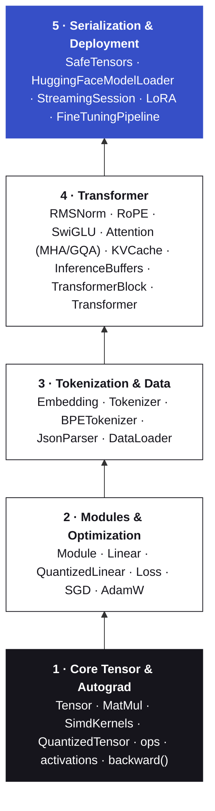

<p align="center">
  <picture>
    <source media="(prefers-color-scheme: dark)" srcset="assets/kotensor-logo-dark.png">
    
  </picture>
</p>

<p align="center">
  <b>Train, fine-tune and run Transformer language models in pure Kotlin — on the JVM and on Android.</b><br>
  Autograd, KV-cached decoding, INT8 / INT4 quantization, BPE tokenization, LoRA / QLoRA and Hugging Face checkpoint import — with no C++, Python or JNI dependencies.
</p>

<p align="center">
  
  
  
  <a href="https://central.sonatype.com/artifact/io.github.tspstudio/kotensor"></a>
  <a href="https://tspstudio.github.io/kotensor/"></a>
  
  
  
</p>

---

## What *is* Kotensor?

Kotensor is a lightweight, pure-Kotlin machine learning and generative Transformer engine for JVM and Android applications. It trains models with reverse-mode automatic differentiation, runs pre-trained Hugging Face checkpoints (Llama, Qwen 2, Mistral, SmolLM) with their own tokenizers, streams text through a KV-cached, allocation-free decoder, shrinks weights to INT8 or INT4, and fine-tunes on device with LoRA — all natively in Kotlin, without external C++, Python or JNI dependencies.

## Why Kotensor

Kotensor implements the whole stack — tensors, reverse-mode autograd, optimizers, a modern decoder-only Transformer, fast inference, quantization, tokenization, LoRA adapters and checkpoint I/O — in plain Kotlin. Its only runtime dependency is the Kotlin standard library (everything else comes from the JDK), so there is no JNI, no native runtime and no Python toolchain to ship, and one JAR serves servers, desktops and phones.

- **Trains, not just infers.** Every op records its backward pass; `backward()` runs reverse-mode autograd over the graph.
- **Modern Transformer blocks.** RMSNorm, rotary position embeddings (with Llama 3 scaling), SwiGLU feed-forward and causal multi-head or grouped-query attention in a pre-norm layout.
- **Fast autoregressive decoding.** A pre-allocated `KVCache` turns generation from re-running the whole sequence per token into a single-token step, and `Transformer.decode` runs that step with zero heap allocations. The prompt is prefilled through a few MB of reusable buffers, however long it is, attention runs on every core, and a cached system prompt is reused instead of recomputed.
- **Multi-core, vectorized matmul.** `MatMul` tiles the product for the cache, accumulates in a form HotSpot auto-vectorizes, and spreads tiles over a `ForkJoinPool` — still plain Kotlin. On JDK 17+, an optional JVM Vector API backend adds explicit SIMD fused multiply-add kernels.
- **Real vocabularies.** `BPETokenizer` loads Hugging Face `tokenizer.json` files (byte-level BPE: GPT-2, Qwen 2.5, SmolLM, Llama 3) with no JSON library, with `<|endoftext|>` / `<|im_start|>` / `<|im_end|>` support.
- **Runs Hugging Face checkpoints.** `HuggingFaceModelLoader.load(directory)` reads `config.json` and `.safetensors` shards (BF16/F16/F32) of Llama-, Qwen2- and Mistral-architecture models — grouped-query attention, tied embeddings and Llama 3 rope scaling included — into a Kotensor `Transformer`.
- **INT8 / INT4 on the edge.** Group-wise weight-only quantization with an on-the-fly dequantizing matmul: a 163M-parameter model drops from 652 MB to 173 MB (INT8) or 95 MB (INT4), saves to a compact file that loads without FP32 copies — or is memory-mapped, so the weights never enter the Java heap — and still trains LoRA adapters on top.
- **Parameter-efficient fine-tuning.** `LoRAAdapter` adds small low-rank matrices to the attention projections and freezes the base weights — FP32 or quantized (QLoRA).
- **Lean training steps.** Autograd skips frozen weights (`requiresGrad`), prompt tokens can be masked out of the loss (`IGNORE_INDEX`), and the output projection and cross-entropy run as one fused pass that never materializes the `[tokens × vocabulary]` logits — half the memory of 1.0.0 and LoRA steps up to 4.8× faster ([measurements](#training-efficiency)).
- **Interoperable weights.** Reads `.safetensors` in F32, F16 and BF16 (including sharded checkpoints), writes F32 checkpoints and compact quantized model files.
- **Runs on Android.** Java 17 bytecode, Android 7.0+ (API 24), no native libraries; the `:sample-android` app streams, quantizes and fine-tunes on the phone. With memory-mapped weights, an INT4 Qwen2-0.5B answers in under 128 MB of heap ([low-memory inference](#low-memory-inference)).
- **Measured and documented.** A JMH suite for FLOP/s, tokens/s and allocations, Dokka API pages, and a Maven Central release pipeline.

## What's new since 0.1.0

| Version | Highlights |
| :-- | :-- |
| 0.2.0 | KV cache with prefill/decode generation and stop tokens; byte-level BPE tokenizer for Hugging Face `tokenizer.json`; incremental UTF-8-safe streaming; rotary-embedding position fix |
| 0.3.0 | Tiled, auto-vectorized, multi-threaded matmul (10–175× the throughput of the naive loop, depending on shape); allocation-free decode step; 3–4× faster generation |
| 0.4.0 | Grouped-/multi-query attention; Llama 3 rope scaling; streaming F16/BF16 `.safetensors` reader; Hugging Face config + weight importer |
| 0.5.0 | INT8 / INT4 group-wise quantization with a dequantizing matmul; QLoRA; compact model files; lazily allocated gradients |
| 1.0.0 | Android-ready Java 17 build; Compose sample app; Dokka docs; Maven Central publishing; JMH benchmarks; CI workflows |
| 1.1.0 | Training efficiency: loss masking with `IGNORE_INDEX`; fused output projection + cross-entropy; `requiresGrad` freezing with early backward termination; matmul backward without transposed copies; optional JVM Vector API (SIMD) kernels; per-batch training telemetry |
| 1.2.0 | Low-memory inference: buffered prompt prefill that never builds a graph and computes the output layer for the last token only; `noGrad`; memory-mapped quantized model files (`loadQuantized(file, memoryMapped = true)`); embeddings tied to the output head, stored once; parallel attention; a reworked single-row quantized kernel, 2.8–4× faster on a phone, with configurable threads and a per-VM INT4 default; sampling (temperature, top-k, top-p, repetition penalty); prompt prefix reuse (`cachePrefix`); Android 7 (API 24) support |

[`CHANGELOG.md`](Engine/kotensor/CHANGELOG.md) explains each change, why it was needed and how it was verified.

## Contents

- [What *is* Kotensor?](#what-is-kotensor)
- [Why Kotensor](#why-kotensor)
- [What's new since 0.1.0](#whats-new-since-010)
- [Installation](#installation)
- [Quick start](#quick-start)
- [Usage guide](#usage-guide)
  - [Training efficiency](#training-efficiency)
  - [Vector API (SIMD) backend](#vector-api-simd-backend)
  - [Low-memory inference](#low-memory-inference)
- [API overview](#api-overview)
- [Current limitations](#current-limitations)
- [Architecture](#architecture)
- [Building from source](#building-from-source)
- [Testing](#testing)
- [Android sample](#android-sample)
- [Benchmarks](#benchmarks)
- [API documentation](#api-documentation)
- [Releasing to Maven Central](#releasing-to-maven-central)
- [Roadmap](#roadmap)
- [License](#license)

## Installation

> **Requirements:** Java 17 or newer. The library is compiled to Java 17 bytecode against the Java 17 API (it is built with a Java 21 toolchain), and its only runtime dependency is the Kotlin standard library.
> **Android:** API 24 (Android 7.0) and newer. There are no native libraries, so there is no ABI split; [`:sample-android`](#android-sample) is a working Compose app built on it. The JAR carries its own R8 rule, so minified builds need no extra configuration. Load models of more than a few tens of MB [memory-mapped](#low-memory-inference), so their weights don't count toward the app's heap limit.
> **Optional SIMD:** on JDK 17+, start the JVM with `--add-modules jdk.incubator.vector` to enable the [Vector API backend](#vector-api-simd-backend).

Kotensor is published on [Maven Central](https://central.sonatype.com/artifact/io.github.tspstudio/kotensor) as `io.github.tspstudio:kotensor:1.2.0`. The API reference is at [tspstudio.github.io/kotensor](https://tspstudio.github.io/kotensor/).

### Gradle (Kotlin DSL)

```kotlin
repositories {
    mavenCentral()
}

dependencies {
    implementation("io.github.tspstudio:kotensor:1.2.0")
}
```

### Maven

```xml
<dependency>
  <groupId>io.github.tspstudio</groupId>
  <artifactId>kotensor</artifactId>
  <version>1.2.0</version>
</dependency>
```

### Maven Local

```bash
./gradlew publishToMavenLocal      # Windows: gradlew.bat publishToMavenLocal
```

Then add `mavenLocal()` to the consuming project's repositories. No signing keys are needed for local publishing.

### Local JAR

```bash
cd Engine/kotensor
./gradlew jar          # Windows: gradlew.bat jar
# → build/libs/kotensor-<version>.jar
```

```kotlin
dependencies {
    implementation(files("libs/kotensor-<version>.jar"))
}
```

All public types live in the `io.kotensor.core` package:

```kotlin
import io.kotensor.core.*
```

## Quick start

Run a pre-trained model downloaded from the Hugging Face Hub, quantized to INT8 while it loads:

```kotlin
import io.kotensor.core.*
import java.io.File

fun main() {
    val directory = File("SmolLM2-135M")   // config.json, model.safetensors, tokenizer.json
    val model = HuggingFaceModelLoader.load(directory, Quantization.INT8)
    val tokenizer = HuggingFaceModelLoader.loadTokenizer(directory)

    model.generateStream("The capital of Mexico is", tokenizer, maxTokens = 32, stopTokens = setOfNotNull(tokenizer.endOfTextId)) { piece ->
        print(piece)
    }
}
```

Or train a tiny character-level language model from scratch and generate text from it:

```kotlin
import io.kotensor.core.*

fun main() {
    val text = "hello hello hello "
    val tokenizer = SimpleTokenizer(text)

    val model = Transformer(
        vocabularySize = tokenizer.vocabularySize,
        dimension = 16,
        numLayers = 1,
        numHeads = 2,
    )
    val optimizer = AdamW(model.parameters(), learningRate = 0.05f)

    val encoded = tokenizer.encode(text)
    val inputs = encoded.sliceArray(0 until encoded.size - 1)
    val targets = encoded.sliceArray(1 until encoded.size)

    repeat(40) {
        val logits = model.forward(inputs)
        val loss = crossEntropyLoss(logits, targets)
        loss.backward()
        optimizer.step()
        optimizer.zeroGrad()
    }

    println(model.generate("h", tokenizer, maxTokens = 5))
}
```

## Usage guide

### Tensors and autograd

A `Tensor` holds a flat `FloatArray` in row-major order, its `shape`, and a `grad` array of the same size. The constructor checks that the data size equals the product of the shape.

```kotlin
val x = Tensor(floatArrayOf(1f, 2f, 3f, 4f), intArrayOf(2, 2))
val w = Tensor(floatArrayOf(0.5f, -1f, 2f, 0f), intArrayOf(2, 2))
val b = Tensor(floatArrayOf(0.1f, 0.2f), intArrayOf(1, 2))

val y = (x matmul w) + b      // a [1, n] tensor broadcasts across the rows of [m, n]
val z = (y * y) * 0.5f        // element-wise product, then scalar multiply

z.backward()                  // seeds z.grad with 1s and runs reverse-mode autograd
println(w.grad.contentToString())
```

| Operation | Notes |
| :-- | :-- |
| `a + b` | Same shape, or a `[1, n]` row broadcast over `[m, n]` (either side) |
| `a - b`, `a * b` | Element-wise; shapes must match exactly |
| `a * 0.5f` | Multiply by a `Float` scalar |
| `a matmul b` | Infix; 2-D only, `[m, k] × [k, n]`; tiled and multi-threaded (see below) |
| `a.transpose()` | 2-D only |
| `a.reshape(intArrayOf(...))` | Copies the data with a new shape |
| `a.relu()`, `a.gelu()`, `a.silu()` | GELU uses the tanh approximation |
| `a.backward()` | Fills `a.grad` with 1s, then back-propagates through the graph |

Gradients **accumulate**. Call `zeroGrad()` on your optimizer (or clear `grad` yourself) between steps. `grad` is allocated on first use, so a model that only runs inference holds one copy of its weights; `hasGrad` tells whether it exists yet.

**Freezing.** Every tensor has a `requiresGrad` flag. Leaves — parameters and inputs — start with `true`, and the result of an operation requires a gradient only if one of its inputs does. Set it to `false` on a tensor, or set `module.requiresGrad = false` for all of a module's parameters, and `backward()` neither computes nor allocates a gradient for it and never enters a subgraph made only of frozen tensors. Optimizers leave frozen tensors untouched.

```kotlin
val layer = Linear(512, 512)
layer.requiresGrad = false        // weight and bias are frozen
val y = layer(x) * 2.0f
y.backward()                      // x.grad is computed; layer.weight.hasGrad stays false
```

**In-place ops** write into tensors you already own, record no graph and allocate nothing — they are what the inference loop is built on:

| Operation | Notes |
| :-- | :-- |
| `a.matmulInto(b, out)` | `out = a × b`; `accumulate = true` adds to `out`, `scale` multiplies the product |
| `a.matmulDequant(q)`, `a.matmulDequantInto(q, out)` | `a × dequantize(q)` for a `QuantizedTensor`, with gradient to `a` only |
| `a.addInto(b, out)`, `a.addInPlace(b)` | Same shapes, or a `[1, n]` row in `b` broadcast over the rows of `a` |
| `a.mulInPlace(b)`, `a.siluInPlace()` | Element-wise, in place |
| `a.copyFrom(b)` | Copies `b`'s values into `a` |

**Matrix multiplication.** `matmul` (forward and backward) and `matmulInto` run on `MatMul.multiply`, which computes the product one `[32, 256]` tile of the result at a time, accumulating in per-thread scratch rows so the inner loop is the `y[j] += a · x[j]` form that HotSpot's C2 compiler auto-vectorizes, with four result rows updated per pass over a row of `b`. Tiles are distributed over a `ForkJoinPool` with one worker per CPU core once a product exceeds `MatMul.parallelThreshold` multiply-adds (default 2¹⁸; set it to `Long.MAX_VALUE` to stay single-threaded). Single-row products — every decode step — use a stripe schedule instead, where each thread streams through the weight matrix once and owns a contiguous range of output columns. On a 2-core AVX-512 machine this reaches ≈ 24 GFLOP/s per thread, compared with ≈ 0.2–2 GFLOP/s for a naive triple loop. `MatMul.multiplyQuantized` is the same design for INT8 / INT4 weights (see [Quantization](#quantization-int8--int4)). The backward pass needs `dC · Bᵀ` and `Aᵀ · dC`: `MatMul.multiplyTransposedB` and `multiplyTransposedA` compute them without transposed copies of the operands — the scalar path transposes `B` one cache-blocked chunk of at most 4 MB at a time, and the [Vector API backend](#vector-api-simd-backend) uses SIMD dot products and needs no copy at all.

### Modules

Subclass `Module` and implement `forward`; override `parameters()` so optimizers can find the trainable tensors. Any module can be called like a function.

```kotlin
class MLP(inSize: Int, hidden: Int, outSize: Int) : Module() {
    val fc1 = Linear(inSize, hidden)
    val fc2 = Linear(hidden, outSize)

    override fun forward(input: Tensor): Tensor = fc2(fc1(input).gelu())

    override fun parameters(): List<Tensor> = fc1.parameters() + fc2.parameters()
}
```

`Linear(inSize, outSize)` computes `input matmul weight + bias`, with `weight` shaped `[inSize, outSize]` and `bias` shaped `[1, outSize]`.

### A training loop

```kotlin
val model = Linear(1, 1)
val optimizer = SGD(model.parameters(), learningRate = 0.1f)

val x = Tensor(floatArrayOf(2f), intArrayOf(1, 1))
val target = Tensor(floatArrayOf(10f), intArrayOf(1, 1))

repeat(50) {
    val loss = mseLoss(model(x), target)
    loss.backward()
    optimizer.step()
    optimizer.zeroGrad()
}
```

Swap `SGD` for `AdamW` for decoupled weight decay:

```kotlin
val optimizer = AdamW(
    parameters = model.parameters(),
    learningRate = 1e-4f,   // default
    beta1 = 0.9f,           // default
    beta2 = 0.999f,         // default
    epsilon = 1e-8f,        // default
    weightDecay = 0.01f,    // default
)
```

### Tokenization and batching

`Tokenizer` is an interface (`vocabularySize`, `encode`, `decode`). `SimpleTokenizer` is a character-level implementation built from a reference text; characters not seen in that text encode as `0`.

`BPETokenizer` is a byte-level byte-pair-encoding tokenizer that loads Hugging Face `tokenizer.json` files directly — vocabulary, merge ranks, pre-tokenization regex, added/special tokens and the post-processing template — using the engine's own `JsonParser`, so there is still no third-party dependency. Raw UTF-8 bytes are mapped to the 256 byte characters before merging, which means any string tokenizes without out-of-vocabulary failures.

```kotlin
import java.io.File

val tokenizer = BPETokenizer.fromFile(File("tokenizer.json"))   // GPT-2, Qwen 2.5, SmolLM, Llama 3 ...

val ids = tokenizer.encode("<|im_start|>user\nHola<|im_end|>")  // special tokens encode as single ids
tokenizer.decode(ids)                                            // "<|im_start|>user\nHola<|im_end|>"
tokenizer.decode(ids, skipSpecialTokens = true)                  // "user\nHola"

tokenizer.endOfTextId   // id of <|endoftext|>, or null
tokenizer.imStartId     // id of <|im_start|>
tokenizer.imEndId       // id of <|im_end|>
tokenizer.tokenId("<|eot_id|>")   // any other special token
tokenizer.encode(text, addSpecialTokens = false)   // skip the template's prefix/suffix tokens (e.g. Llama 3's <|begin_of_text|>)
```

`vocabularySize` is the largest id plus one, so it can be used directly as the `Transformer`'s vocabulary size. A tokenizer can also be built in code from a `vocab` map and a `merges` list. SentencePiece-style files (`Metaspace` pre-tokenizer, `byte_fallback` with `<0xNN>` tokens — Llama 2, Mistral) are not supported.

`DataLoader` slices a token array into consecutive next-token batches. Each `nextBatch()` returns `(inputs, targets)` as tensors shaped `[batchSize, sequenceLength]`, with targets shifted one token ahead. `Transformer.forward` treats each row of that batch as its own sequence.

```kotlin
val loader = DataLoader(tokens = encoded, batchSize = 4, sequenceLength = 8)

while (loader.hasNext()) {
    val (x, y) = loader.nextBatch()
    val loss = crossEntropyLoss(model.forward(x), y)
    loss.backward()
    optimizer.step()
    optimizer.zeroGrad()
}
loader.reset()
```

**Loss masking.** For instruction tuning, the loss should come from the response tokens only. Give `DataLoader` a `labels` array the same length as `tokens`: the target of position *i* is `labels[i + 1]`, and positions labelled `IGNORE_INDEX` (−100) are left out. `DataLoader.promptMasked` builds both arrays from (prompt, response) pairs:

```kotlin
val examples = pairs.map { (prompt, response) -> tokenizer.encode(prompt) to tokenizer.encode(response) }
val loader = DataLoader.promptMasked(examples, batchSize = 1, sequenceLength = 64)   // prompt targets are IGNORE_INDEX
```

`crossEntropyLoss(logits, targets)` skips rows whose target is `IGNORE_INDEX` (pass `ignoreIndex` to use another value): no softmax is computed for them, they receive no gradient, and the loss is the mean over the remaining rows — 0, with nothing to back-propagate, if every row is masked.

### The Transformer

```kotlin
val model = Transformer(
    vocabularySize = 256,
    dimension = 64,
    numLayers = 4,
    numHeads = 4,
    hiddenDimension = 256,   // optional, defaults to 4 × dimension
)

val logits = model.forward(intArrayOf(1, 2, 3))   // one sequence → shape [3, vocabularySize]

// A 2-D tensor of token IDs is read as [batch, sequenceLength]; rows don't attend to each other.
val batch = Tensor(floatArrayOf(1f, 2f, 3f, 4f, 5f, 6f), intArrayOf(2, 3))
val batchLogits = model.forward(batch)              // shape [2 × 3, vocabularySize]
```

Each `TransformerBlock` is pre-norm: `x + Attention(RMSNorm(x))`, then `+ SwiGLU(RMSNorm(·))`. Attention is causal, with rotary embeddings applied to queries and keys.

Grouped-query attention (GQA) and multi-query attention (MQA) are selected with `numKeyValueHeads`; the remaining constructor parameters follow the Hugging Face `config.json` fields:

```kotlin
val model = Transformer(
    vocabularySize = 49152,
    dimension = 576,
    numLayers = 30,
    numHeads = 9,
    hiddenDimension = 1536,
    numKeyValueHeads = 3,        // 3 key/value heads shared by 9 query heads; defaults to numHeads
    normEps = 1e-5f,             // rms_norm_eps
    ropeTheta = 100000.0f,       // rope_theta
    ropeScaling = null,          // RoPEScaling(factor, lowFrequencyFactor, highFrequencyFactor, originalMaxPositionEmbeddings) for Llama 3
)
```

With fewer key/value heads, `wK` and `wV` project to `numKeyValueHeads × headDim`, and the KV cache shrinks by the same factor.

**Generation** (greedy — picks the highest-scoring token at each step):

```kotlin
val tokens: IntArray = model.generate(prompt = intArrayOf(1, 2), maxTokens = 32)
val text: String = model.generate("h", tokenizer, maxTokens = 32)

// Token-by-token
for (token in model.generateStream(intArrayOf(1, 2), maxTokens = 32)) { /* ... */ }
model.generateStream("h", tokenizer, maxTokens = 32) { piece -> print(piece) }

// Stop early on an end-of-text token (not emitted)
model.generate(prompt, maxTokens = 256, stopTokens = setOfNotNull(tokenizer.endOfTextId))
```

Generation runs through a **KV cache**: the prompt is prefilled first — 32 tokens at a time through reusable buffers, computing the output layer for the last prompt token only — and every further step feeds back only the token just produced, attending to the cached keys and values. A step therefore costs O(position) instead of re-running the whole sequence, and the output is the same as the uncached forward pass. Those steps go through `decode`, which keeps every intermediate in a pre-allocated `InferenceBuffers` — no heap allocation per token, so the garbage collector stays idle while text streams. Text streaming decodes incrementally, so a character spread over several byte-level tokens is delivered once it is complete.

A chat app sends the same system prompt with every message. Cache it once and pass it to `generate` / `generateStream`; the positions that match the start of the prompt are copied instead of recomputed, and the output is the same as without the prefix:

```kotlin
val system = model.cachePrefix(tokenizer.encode("<|im_start|>system\nYou are a helpful tutor."))
val reply = model.generateStream(tokenizer.encode(fullPrompt), maxTokens = 128, stopTokens = stops, prefix = system)
```

Generation is greedy unless you pass a `Sampling`:

```kotlin
val sampling = Sampling(temperature = 0.7f, topK = 40, topP = 0.9f, repetitionPenalty = 1.1f, repetitionWindow = 64)
val varied = model.generateStream(tokenizer.encode(fullPrompt), maxTokens = 128, stopTokens = stops, sampling = sampling)
```

The repetition penalty covers the last `repetitionWindow` tokens of the prompt and of the generated text. `Sampling.GREEDY` is the default behavior, and a `seed` makes a sampled run repeatable.

To drive the cache yourself (for example to keep a conversation's context between turns):

```kotlin
val cache = model.newCache(maxSequenceLength = 512)   // [layers, heads, 512, headDim] × keys and values
val buffers = model.newInferenceBuffers(maxSequenceLength = 512)

var logits = model.prefill(promptTokens, cache, buffers)   // buffers.logits for the last prompt token; cache.length == promptTokens.size
logits = model.decode(nextToken, cache, buffers)       // one allocation-free step → buffers.logits, shaped [1, vocabularySize]
logits = model.forward(intArrayOf(nextToken), cache)   // the same step through the graph path (allocates)
cache.remaining                                        // positions left before it is full
other.copyFrom(cache, length = 10)                     // the first 10 positions into another cache of the same model
cache.reset()                                          // start a new sequence
```

`prefill`, `forward(indices, cache)` and `decode` are inference-only: no gradient is recorded through the cache. `forward(promptTokens, cache)` still prefills too, but returns the logits of every position, so it allocates `[tokens × vocabulary]` floats; `prefill` keeps only the last row. `prefill` and `decode` return `buffers.logits` itself, so read it before the next call.

### Saving and loading weights

```kotlin
import java.io.File

SafeTensors.save(File("model.safetensors"), model.namedParameters())

val restored = Transformer(vocabularySize = 256, dimension = 64, numLayers = 4, numHeads = 4)
restored.loadParameters(SafeTensors.load(File("model.safetensors")))
```

`loadParameters` copies every tensor whose name matches and skips names that are missing; sizes must match. Parameter names follow the pattern `embedding.weight`, `block.<n>.attention.wQ.weight`, `block.<n>.ffn.wGate.bias`, `finalNorm.weight`, `lmHead.weight`, and so on.

`SafeTensors.load` reads every tensor as F32 regardless of how it is stored (`F32`, `F16`, `BF16`, `F64` and integer dtypes are converted). To read selectively, or to avoid holding a whole checkpoint in memory, open the file instead:

```kotlin
SafeTensors.open(File("model.safetensors")).use { reader ->
    reader.names                              // tensor names in file order
    reader.entry("model.norm.weight").dtype   // "BF16"
    reader.entry("model.norm.weight").shape   // [576]
    reader.readInto("model.norm.weight", target.data)   // converts straight into an existing FloatArray
    reader.load("lm_head.weight")             // a new Tensor
}
```

### Loading Hugging Face models

A model directory as downloaded from the Hub — `config.json`, `model.safetensors` (or `model-0000x-of-0000y.safetensors` plus `model.safetensors.index.json`) and `tokenizer.json` — loads directly:

```kotlin
import java.io.File

val directory = File("SmolLM2-135M")
val model = HuggingFaceModelLoader.load(directory) { name -> println("loaded $name") }
val tokenizer = HuggingFaceModelLoader.loadTokenizer(directory)

val session = StreamingSession(model, tokenizer)
session.stream("The capital of Mexico is", maxTokens = 64, stopTokens = setOfNotNull(tokenizer.endOfTextId)) { state ->
    print(state.generatedText)
}
```

Supported `model_type`s are `llama` (Llama 2/3, SmolLM, TinyLlama), `qwen2` (Qwen 2 / 2.5) and `mistral`; they share the pre-norm RMSNorm / rotary / SwiGLU decoder that `Transformer` implements. The importer reads `hidden_size`, `num_hidden_layers`, `num_attention_heads`, `num_key_value_heads`, `intermediate_size`, `rms_norm_eps`, `rope_theta`, `vocab_size`, `tie_word_embeddings` and a `llama3` `rope_scaling`, builds the `Transformer`, then maps every tensor by name:

| Hugging Face | Kotensor |
| :-- | :-- |
| `model.embed_tokens.weight` | `embedding.weight` |
| `model.layers.{i}.input_layernorm.weight` | `block.{i}.norm1.weight` |
| `model.layers.{i}.self_attn.{q,k,v,o}_proj.{weight,bias}` | `block.{i}.attention.{wQ,wK,wV,wOut}.{weight,bias}` (weights transposed to `[in, out]`) |
| `model.layers.{i}.post_attention_layernorm.weight` | `block.{i}.norm2.weight` |
| `model.layers.{i}.mlp.{gate,up,down}_proj.weight` | `block.{i}.ffn.{wGate,wUp,wDown}.weight` (transposed) |
| `model.norm.weight` | `finalNorm.weight` |
| `lm_head.weight` (or the embedding when tied) | `lmHead.weight` (transposed) |

Missing biases stay zero (Llama has none; Qwen's q/k/v biases are loaded), tensors Kotensor has no place for (such as `rotary_emb.inv_freq`) are listed in the returned `ImportReport.ignored`, and a checkpoint missing any weight fails with the names. `HuggingFaceModelLoader.loadConfig`, `newModel`, `weightFiles` and `loadWeights` expose the individual steps.

Memory: the model plus one checkpoint tensor at a time while importing. A tied output head is stored as its own transposed copy, so SmolLM2-135M occupies ≈ 652 MB in FP32, ≈ 173 MB with `HuggingFaceModelLoader.load(directory, Quantization.INT8)` and ≈ 95 MB with `Quantization.INT4`. Gradient arrays are only allocated if you train.

### LoRA fine-tuning

`LoRAAdapter` wraps the query (`wQ`) and value (`wV`) projections of every attention block in a `LoRALinear` and freezes every base weight (`requiresGrad = false`; `merge()` restores it). Give the optimizer only the adapter's parameters.

```kotlin
val adapter = LoRAAdapter(model, rank = 4, alpha = 1.0f)          // defaults: rank 4, alpha 1.0
val optimizer = AdamW(adapter.parameters(), learningRate = 0.05f)
val pipeline = FineTuningPipeline(model, adapter, optimizer)

pipeline.train(
    loader,
    epochs = 3,
    onBatchEnd = { epoch, batch, totalBatches, loss ->
        print("\r[Epoch $epoch/3 | Batch $batch/$totalBatches | Loss: ${"%.2f".format(loss)} | ${100 * batch / totalBatches}%]")
    },
    onEpochEnd = { epoch, averageLoss -> println("\nepoch $epoch — average loss $averageLoss") },
)

pipeline.exportAdapter(File("adapter.safetensors"))   // saves only the low-rank A/B matrices
```

`onBatchEnd` reports every batch (1-based, out of `totalBatches`), so long CPU runs show progress instead of looking frozen; `onEpochEnd` reports the average loss of the epoch's batches. A trailing lambda still means `onEpochEnd`, so `pipeline.train(loader, epochs) { epoch, loss -> … }` works as before.

Because the base is frozen, backpropagation computes gradients only for what can still change — the adapters and the activations leading to them — and never runs below the lowest adapted block. `LoRAAdapter(model, blockIndices = 20 until 24)` adapts only the top four blocks of a 24-block model, and the backward pass then stops after those four.

Later, on a model built with the same configuration:

```kotlin
val adapter = LoRAAdapter(model, rank = 4, alpha = 1.0f)
val pipeline = FineTuningPipeline(model, adapter, AdamW(adapter.parameters()))
pipeline.loadAdapter(File("adapter.safetensors"))
pipeline.mergeAdapter()   // folds scaling × (A · B) into the base weights and removes the LoRA wrappers
```

After merging, the model is a plain `Transformer` again — save it with `SafeTensors.save(file, model.namedParameters())` and load it without an adapter. Before merging, `namedParameters()` exports the base weights and `exportAdapter` exports the adapter separately.

`FineTuningPipeline.trainStep(input, target)` runs a single forward/backward/optimizer step through the fused, masked `model.loss` (next section) and returns the loss if you want your own loop. A batch whose targets are all masked returns 0 without updating anything, and is left out of the epoch average.

Adapters also attach to a quantized model (QLoRA): the frozen INT8/INT4 base stays compact, gradients flow through it to the adapters, and `exportAdapter` saves them as before. `mergeAdapter()` is refused on a quantized base, since there are no FP32 weights to fold into.

### Training efficiency

`Transformer.loss(input, targets)` is the training entry point. It runs the model up to the final normalization (`hiddenStates`) and passes the result to `fusedCrossEntropyLoss`, which projects only the rows whose target is not `IGNORE_INDEX`, a few rows at a time (at most 16 MB of logits), and computes the softmax, the loss and the gradient with respect to the hidden states in the same pass. The `[tokens × vocabulary]` logits tensor never exists, and when the output head is frozen its weight gradient is never computed. The result equals `crossEntropyLoss(model.forward(input), targets)` — loss and gradients alike.

```kotlin
val loss = model.loss(inputs, targets)                      // fused projection + masked cross-entropy
loss.backward()

val hidden = model.hiddenStates(inputs)                     // [tokens, dimension]
val same = fusedCrossEntropyLoss(hidden, model.lmHead as Projection, targets)   // any Linear or QuantizedLinear head
```

Measured on a model with Qwen2-0.5B's shape — dimension 896, 14 query / 2 key-value heads, feed-forward size 4,864, a 151,936-token vocabulary — with rank-8 LoRA on the query and value projections and a batch of 64 tokens (18 of them response tokens when masked), on a 2-core AVX-512 container:

| Seconds per training step | 1.0.0 | 1.1.0 | 1.1.0, masked | 1.1.0 + Vector API | 1.1.0 + Vector API, masked |
| :-- | --: | --: | --: | --: | --: |
| 4 layers | 3.87 | 2.97 | 1.46 | 1.47 | 0.81 |
| 8 layers | 4.84 | 3.95 | 2.07 | 2.05 | 1.19 |
| 24 layers (full depth) | out of memory (6 GB heap) | 6.44 | 4.62 | 3.66 | 3.04 |

The heap after a step fell from 2.77 GB to 1.39 GB at 4 layers and from 3.35 GB to 1.68 GB at 8; the full 24-layer model trains in 2.84 GB, where 1.0.0 ran out of a 6 GB heap because it allocated a gradient array for every frozen weight. The output layer alone — projection and loss, forward and backward, for 64 tokens — went from 2.7 s to 2.0 s, to 0.70 s with masking, and to 0.33 s with masking and the Vector API.

### Vector API (SIMD) backend

HotSpot auto-vectorizes the matmul's `y += a · x` loops but never a floating-point reduction, so the dot products of `A · Bᵀ` — the input gradient of every projection — stay scalar. On JDK 17 and newer, Kotensor can use the JVM's incubating Vector API instead. Start the JVM with the module added:

```bash
java --add-modules jdk.incubator.vector -jar app.jar
```

```kotlin
tasks.withType<JavaExec>().configureEach {
    jvmArgs("--add-modules", "jdk.incubator.vector")
}
```

`MatMul` then runs explicit SIMD kernels (`FloatVector.SPECIES_PREFERRED` with fused multiply-add) in its tiled FP32 and dequantizing kernels and in the backward kernels: on the machine above, the tiled matmul is 1.2–1.6× and `A · Bᵀ` 1.8–4.1× faster than the scalar kernels. `MatMul.vectorApiAvailable` reports whether the backend loaded, `MatMul.useVectorApi = false` switches it off at run time, and `-Dkotensor.vectorApi=false` stops it from loading. Without the module — and always on Android, whose runtime has no Vector API — the scalar kernels run as before. Single-row forward products, which is every decode step, always use the scalar kernels, so decoding stays allocation-free. The JVM prints `WARNING: Using incubator modules: jdk.incubator.vector` at start-up; that is expected.

### Quantization (INT8 / INT4)

Weight-only quantization keeps activations in FP32 and dequantizes weights inside the matmul, one row segment at a time, so the full FP32 matrix never exists in memory:

```kotlin
val model = HuggingFaceModelLoader.load(directory)          // FP32
model.quantize(Quantization.INT8)                           // in place: every projection and the embedding table
model.weightBytes()                                         // bytes held by the weights

val compact = HuggingFaceModelLoader.load(directory, Quantization.INT4)   // quantize while importing
compact.saveQuantized(File("model-int4.safetensors"))
val onDevice = Transformer.loadQuantized(File("model-int4.safetensors"))  // never allocates FP32 weights
val mapped = Transformer.loadQuantized(File("model-int4.safetensors"), memoryMapped = true)   // weights stay in the file, off the heap
```

| | bytes per weight | scheme |
| :-- | :-- | :-- |
| FP32 | 4 | — |
| `Quantization.INT8` | 1 + 4 / groupSize | symmetric, `scale · q`, one scale per column per group of 64 rows |
| `Quantization.INT4` | 0.5 + 5 / groupSize | asymmetric, `scale · (q − zero)`, two columns per byte |

`Quantization(bits, groupSize)` picks the group size (smaller groups: more accurate, slightly larger). `QuantizedLinear` and `QuantizedEmbedding` behave like `Linear` / `Embedding` in every path — graph forward, cached forward, allocation-free `decode` — and `QuantizedTensor.quantize` / `dequantize` are available directly. A quantized model can't be trained (its weights are frozen) except through LoRA adapters.

Measured on a SmolLM2-135M-shaped model (163 M parameters, 2-core container): FP32 652 MB at 8.6 tokens/s, INT8 173 MB at 12.2 tokens/s, INT4 95 MB at 8.0 tokens/s. The INT4 kernel is compute-bound on unpacking nibbles, so it trades a little speed for a 7× smaller footprint. That is HotSpot; on Android the single-row INT4 kernel uses a lookup table instead of unpacking by default (`MatMul.lookupInt4`), because ART converts bytes to floats slowly.

### Low-memory inference

Android caps each app's Java heap — typically at 256 or 512 MB even with `android:largeHeap`, however much RAM the phone has — and every weight array counts toward it. Three features keep inference inside that limit:

```kotlin
val model = Transformer.loadQuantized(File(context.filesDir, "model-int4.safetensors"), memoryMapped = true)
model.namedQuantizedTensors().values.all { it.isMemoryMapped }   // true: the weights stay in the file

val reply = model.generate(promptTokens, maxTokens = 128, stopTokens = setOfNotNull(tokenizer.imEndId))
```

- **Memory-mapped model files.** `loadQuantized(file, memoryMapped = true)` maps the packed weights, scales and zero points of a `saveQuantized` file instead of copying them into arrays; only norm weights and biases go on the heap. The operating system pages the weights in as they are used and can drop them again under memory pressure. Output and decoding speed are identical to a heap-loaded model. Reading `qdata`, `scales` or `zeros` of a mapped tensor copies that tensor onto the heap. Don't overwrite the file in place while a model maps it: write a new file and rename it over the old one.
- **Buffered prompt prefill.** `generate`, `generateStream` and `StreamingSession` run the prompt through `prefill`, so its memory doesn't grow with the prompt: about 2 MB for Qwen2-0.5B, where 1.1.0 held about 5 MB per prompt token until the first generated token.
- **`noGrad`.** Inference through the graph API — `model.forward(tokens)` to score text, for example — still records an autograd graph that holds every intermediate. Inside `noGrad`, results keep no reference to their inputs, so each one is released as soon as it has been used:

```kotlin
val logits = noGrad { model.forward(tokens) }
```

- **Tied embeddings.** Models with `tie_word_embeddings` (Qwen2-0.5B and SmolLM2, for example) share one matrix between the token embedding and the output layer, but the importer keeps two copies. `tieEmbeddingToHead()` makes the embedding read the columns of the quantized output head, and `saveQuantized` then stores the matrix once; `loadQuantized` restores the tie. The head's quantization groups along the other axis, so the input embeddings change slightly — compare the model's answers before shipping a tied file.

```kotlin
Transformer.loadQuantized(File("model-int4.safetensors"))
    .tieEmbeddingToHead()
    .saveQuantized(File("model-int4-tied.safetensors"))
```

Measured with an INT4 Qwen2-0.5B fine-tune (366 MB file) on JDK 21, 2-core container:

| | 1.1.0 | 1.2.0 | 1.2.0, mapped | 1.2.0, mapped and tied |
| :-- | --: | --: | --: | --: |
| Heap limit it runs in | out of memory at 512 MB | 512 MB | 128 MB | 128 MB |
| Heap held by the model | 350 MB | 350 MB | 3 MB | 3 MB |
| First token (75-token prompt) | 5.2 s | 2.6 s | 2.9 s | 3.2 s |
| First token (367-token prompt) | 24.0 s | 10.3 s | 11.3 s | 10.5 s |
| Each decoded token | 0.19 s | 0.15 s | 0.15 s | 0.15 s |
| File size | 366 MB | 366 MB | 366 MB | 288 MB |

Only the KV cache grows with the conversation: 24 KB per token of context for this model, so 1,600 tokens add 39 MB. Time grows faster than memory — a 1,600-token prompt takes 60 s to its first token on that container (81 s before attention ran on every core) — so on a phone, keep prompts short and stream the reply. The first answer after a mapped file has left the page cache also includes reading it from storage.

### Streaming generation with telemetry

`StreamingSession` runs generation and reports a `GenerationState` after every token — ready to drive a UI. It has no UI-framework dependency.

```kotlin
val session = StreamingSession(model, tokenizer)

val finalState = session.stream(prompt = "h", maxTokens = 64) { state ->
    // state.prompt, state.generatedText, state.isGenerating,
    // state.tokensGenerated, state.tokensPerSecond
}

session.cancel()   // safe to call from another thread; stops before the next token
```

`stream()` is synchronous: it returns the final state once generation finishes or is cancelled. Pass `stopTokens = setOfNotNull(tokenizer.endOfTextId)` to end a reply at the model's end-of-text token.

## API overview

| Area | Type / function | Purpose |
| :-- | :-- | :-- |
| Core | `Tensor`, `noGrad` | Data, shape, lazily allocated gradient, `requiresGrad` / `hasGrad`, ops, in-place ops and `backward()`; `noGrad { }` runs a block without recording the graph |
| | `MatMul` | Tiled / striped, auto-vectorized, multi-threaded FP32 and dequantizing matmul kernels, `Aᵀ · B` / `A · Bᵀ` variants, transpose, optional Vector API backend (`useVectorApi`), a thread count that can change at runtime (`numThreads`) and the INT4 single-row kernel choice (`lookupInt4`) |
| | `Quantization`, `QuantizedTensor` | INT8 / INT4 group-wise weight quantization, on the heap or memory-mapped (`isMemoryMapped`); `dequantizeRow` / `dequantizeColumn` |
| | `Module` | Base class: `forward`, `parameters`, `invoke`, `requiresGrad` |
| Layers | `Projection`, `Linear`, `QuantizedLinear` | Affine layers, FP32 or quantized; `forwardInto` |
| | `TokenEmbedding`, `Embedding`, `QuantizedEmbedding`, `TiedQuantizedEmbedding` | Token-index lookup tables (the tied one reads the quantized output head); `lookupInto` |
| | `RMSNorm` | Root-mean-square normalization with a learned scale; `forwardInto` |
| | `RoPE`, `RoPEScaling` | Rotary position embeddings (`apply(input, startPosition)`), per head, with optional Llama 3 frequency scaling; `applyInPlace` / `applyRowsInPlace` |
| | `SwiGLU` | Gated feed-forward network (`wGate`, `wUp`, `wDown`); `forwardInto` |
| | `Attention` | Causal multi-head / grouped-query self-attention: full-sequence, cached, buffered prefill, or allocation-free `decodeInto` |
| | `TransformerBlock` | Pre-norm attention + SwiGLU block; `decodeInto` |
| | `Transformer` | Decoder-only model: forward, `hiddenStates`, fused `loss`, cached generation (optionally from a `PromptPrefix`), `prefill`, `decode`, `cachePrefix`, named weights, `quantize`, `tieEmbeddingToHead`, `saveQuantized` / `loadQuantized` (on the heap or memory-mapped) |
| | `KVCache`, `PromptPrefix` | Pre-allocated `[layers, heads, maxSequenceLength, headDim]` key/value buffers, `copyFrom`; a cached prompt opening (`cachePrefix`) that generation reuses |
| | `InferenceBuffers` | Pre-allocated activations for `decode` and the last-token output of `prefill` |
| | `Sampling`, `Sampler` | Temperature, top-k, top-p and repetition-penalty settings for `generate` / `generateStream` / `StreamingSession.stream`; `Sampling.GREEDY` |
| Losses | `mseLoss(prediction, target)` | Mean squared error |
| | `crossEntropyLoss(logits, targets, ignoreIndex)` | Softmax cross-entropy; targets as `IntArray` or `Tensor`; rows labelled `IGNORE_INDEX` (−100) are skipped |
| | `fusedCrossEntropyLoss(hidden, head, targets, ignoreIndex)` | Output projection + masked cross-entropy in one chunked pass, without materializing the logits |
| Optimizers | `SGD` | Plain gradient descent |
| | `AdamW` | Adam with decoupled weight decay; both optimizers skip frozen tensors |
| Data | `Tokenizer`, `SimpleTokenizer` | Text ↔ token IDs (character-level implementation) |
| | `BPETokenizer` | Byte-level BPE from Hugging Face `tokenizer.json`, special tokens |
| | `IncrementalDecoder` | Streams decoded text, holding back incomplete multi-byte characters |
| | `DataLoader` | Sequential next-token batches; optional `labels` for loss masking, `promptMasked` for (prompt, response) pairs |
| I/O | `SafeTensors`, `SafeTensorsFile`, `SafeTensorsEntry` | `save` / `saveEntries` (any dtype, metadata) / `load` / `open` with per-tensor and raw reads, memory-mapped `map`, F16 / BF16 / F64 conversion |
| | `HuggingFaceModelLoader`, `HuggingFaceConfig`, `ImportReport` | `config.json` + `.safetensors` (sharded) importer for Llama / Qwen2 / Mistral checkpoints |
| | `JsonParser` | Minimal zero-dependency JSON reader (`parse(text)`) |
| Fine-tuning | `LoRALinear`, `LoRAAdapter` | Low-rank adapters on attention `wQ` / `wV` of all or selected blocks; freeze the base while attached |
| | `FineTuningPipeline` | Training loop with per-batch and per-epoch callbacks, adapter export/import, merge |
| Deployment | `StreamingSession`, `GenerationState` | Token streaming with cancellation and tokens/sec |

Generated API documentation: see [API documentation](#api-documentation).

## Current limitations

These describe the current code, so you can plan around them:

- **Precision and device:** `Float` (F32) only, on the CPU. Matrix multiplication is tiled, auto-vectorized by the JIT (or SIMD through the optional Vector API) and multi-threaded; cached attention is split across heads and tokens on the same threads; normalization and the element-wise ops are plain single-threaded loops.
- **Shapes:** `matmul` and `transpose` take 2-D tensors. `+` broadcasts only a `[1, n]` row; `-` and `*` need identical shapes.
- **Batching:** sequences in a batch must all have the same length (there is no padding mask), and attention memory grows with `(batch × sequenceLength)²`. Loss masking removes tokens from the loss only: attention still sees them, and examples packed into one sequence can attend to earlier examples.
- **Generation:** greedy by default; `Sampling` adds temperature, top-k, top-p and a repetition penalty, and the penalty also covers the prompt tokens inside its window. The KV cache is F32 and sized up front (`2 × layers × heads × maxSequenceLength × headDim` floats); `prefill`, `forward(indices, cache)` and `decode` record no gradient. `decode` itself allocates nothing; a multi-threaded matmul inside it creates a few fork/join task objects per call, and the `Sequence` returned by `generateStream` boxes each yielded id.
- **Memory:** gradient arrays appear on first use, so training doubles the FP32 footprint of the weights being trained (frozen weights never get one); without the Vector API, the backward pass transposes weights in chunks of at most 4 MB. Memory mapping covers quantized model files only: FP32 checkpoints and Hugging Face imports are read onto the heap, and so is the tokenizer (tens of MB for a 150,000-token vocabulary). On Windows, a mapped file can't be deleted or replaced while a model still maps it.
- **Tokenizer:** byte-level BPE only; SentencePiece-style `tokenizer.json` files (`Metaspace`, `byte_fallback`) are not supported. Of the pre-tokenizers, `Split` and `ByteLevel` are applied and others (such as `Digits`) are skipped, and added tokens' `lstrip` / `rstrip` / `single_word` flags are ignored.
- **Importer:** `model_type` llama / qwen2 / mistral only (Gemma's `1 + w` norms, Phi-3's fused QKV and Qwen3's q/k norms are rejected), `rope_scaling` only of type `llama3`, `head_dim` must equal `hidden_size / num_attention_heads`.
- **Quantization:** weight-only (activations and the KV cache stay FP32), round-to-nearest with per-group min/max — no calibration or GPTQ/AWQ-style error correction; pre-quantized GGUF / AWQ files are not read. Norm weights and biases stay FP32. A tied embedding uses the output head's quantization, which groups 64 dimensions of one token instead of 64 tokens of one dimension.
- **LoRA scope:** adapters cover attention `wQ` and `wV` only, in all blocks or a chosen subset.
- **Vector API:** the module is still incubating in the JDK, so it must be added with `--add-modules jdk.incubator.vector`; Android always runs the scalar kernels.
- **SafeTensors:** writes F32 only; reads convert every dtype to F32.
- **Android performance:** the kernels were tuned on HotSpot and measured on one phone (see [Benchmarks](#benchmarks)). ART compiles the same code with a different optimizer, so other devices have to be measured; the sample app shows live tokens/s for that reason.

## Architecture

Kotensor is 28 source files in five layers. Each layer builds only on the ones beneath it.



```text
Kotensor/
├── .github/workflows/            # ci.yml · docs.yml · release.yml
├── assets/                       # logos and app icon
└── Engine/kotensor/              # Gradle project (rootProject.name = "kotensor")
    ├── build.gradle.kts          # library: Kotlin/JVM, Dokka, Maven Central publishing
    ├── settings.gradle.kts       # :benchmark, and :sample-android with -Pkotensor.android=true
    ├── gradle.properties
    ├── gradlew / gradlew.bat     # Gradle 9.2.1 wrapper
    ├── Module.md                 # module overview rendered by Dokka
    ├── Milestone.md  CHANGELOG.md
    ├── benchmark/                # JMH suite (src/jmh/kotlin)
    ├── sample-android/           # Jetpack Compose demo app
    └── src/
        ├── main/kotlin/          # package io.kotensor.core
        │   ├── Tensor.kt  MatMul.kt  SimdKernels.kt  QuantizedTensor.kt  Module.kt  Linear.kt  QuantizedLinear.kt  Loss.kt  SGD.kt  AdamW.kt
        │   ├── Embedding.kt  Tokenizer.kt  BPETokenizer.kt  JsonParser.kt  DataLoader.kt
        │   ├── RMSNorm.kt  RoPE.kt  SwiGLU.kt  Attention.kt  KVCache.kt  InferenceBuffers.kt
        │   ├── TransformerBlock.kt  Transformer.kt
        │   └── SafeTensors.kt  HuggingFaceModelLoader.kt  StreamingSession.kt  LoRA.kt  FineTuningPipeline.kt
        ├── main/resources/       # META-INF/proguard/kotensor.pro (R8 rule for Android consumers)
        └── test/
            ├── kotlin/
            │   ├── CoreTensorTest.kt
            │   ├── MatMulTest.kt
            │   ├── TransformerTest.kt
            │   ├── Phase5Test.kt
            │   ├── RegressionTest.kt
            │   ├── KVCacheTest.kt
            │   ├── InferenceTest.kt
            │   ├── GQATest.kt
            │   ├── HuggingFaceImportTest.kt
            │   ├── QuantizationTest.kt
            │   ├── BPETokenizerTest.kt
            │   ├── TrainingTest.kt
            │   ├── PrefillTest.kt
            │   ├── MappedModelTest.kt
            │   ├── PromptPrefixTest.kt
            │   └── ParallelAttentionTest.kt
            └── resources/        # reference tokenizer.json files + encodings from Hugging Face `tokenizers`;
                                  # hf/: tiny Llama/Qwen-style checkpoints with NumPy reference logits
```

## Building from source

**Toolchain:** Kotlin 2.3.20 · Gradle 9.2.1 (wrapper included) · Java 21 toolchain emitting Java 17 bytecode. The Foojay toolchain resolver is configured, so Gradle can download a matching JDK if none is installed.

```bash
git clone https://github.com/TSPstudio/kotensor.git
cd kotensor/Engine/kotensor
./gradlew build                                            # Windows: gradlew.bat build
./gradlew dokkaGenerate                                    # API docs → build/dokka/html
./gradlew :benchmark:jmh                                   # JMH suite
./gradlew :benchmark:jmh -Pkotensor.vectorApi=true         # JMH suite with the Vector API backend
./gradlew -Pkotensor.android=true :sample-android:installDebug   # Android sample on a device
```

| Plugin | Version | Why this version |
| :-- | :-- | :-- |
| Kotlin JVM | 2.3.20 | Unchanged project baseline |
| Dokka | 2.2.0 | Latest stable; Dokka Gradle plugin v2 and K2 analysis by default |
| `com.vanniktech.maven.publish` | 0.37.0 | Central Portal publishing; requires Gradle ≥ 9.0 and Kotlin ≥ 2.2 |
| `me.champeau.jmh` | 0.7.3 | Latest release of the standard JMH Gradle plugin |
| Android Gradle plugin | 9.0.1 | Newest AGP that supports Gradle 9.2.1 (AGP 9.1 needs Gradle 9.3.1, 9.2 needs 9.4.1) |

## Testing

```bash
./gradlew test
```

124 tests across eighteen suites, run on the JUnit Platform with `kotlin-test`. `./gradlew test` runs them with the default scalar kernels and then again as `vectorApiTest`, with `--add-modules jdk.incubator.vector`, so both backends are checked:

| Suite | Tests |
| :-- | :-- |
| `CoreTensorTest` (4) | Transpose & reshape · activations · arithmetic & broadcasting · `Linear` + `SGD` convergence |
| `MatMulTest` (5) | Tiled kernel vs naive on odd shapes (incl. accumulate/scale) · parallel vs serial · transpose · `matmul` backward vs naive gradients · in-place ops |
| `TransformerTest` (3) | Block forward/backward · cross-entropy · end-to-end training and generation |
| `Phase5Test` (5) | SafeTensors save/load · model weight persistence · LoRA fine-tuning · streaming & cancellation · fine-tuning pipeline |
| `RegressionTest` (4) | Batched sequences match single-sequence output · LoRA merge applies the delta once · RoPE rotates every head by the token position · weight export with LoRA attached |
| `KVCacheTest` (8) | Buffer layout · cached decode matches the full forward (plain and with LoRA) · `generate` matches uncached greedy decoding · stop tokens · capacity checks · reset · streaming text |
| `InferenceTest` (5) | `decode` matches the graph forward (plain and with LoRA) · in-place modules match their graph versions · a decode step allocates 0 bytes (`ThreadMXBean`) · cache/buffer checks |
| `GQATest` (6) | Grouped-query output equals multi-head with replicated K/V · gradients sum over the group · cached and decode paths with grouped heads · training · invalid groupings · rope theta and Llama 3 scaling |
| `HuggingFaceImportTest` (7) | Llama-style BF16 checkpoint matches a NumPy reference (forward and decode) · sharded Qwen-style F16/F32/BF16 with biases, MQA and tied embeddings · Llama 3 rope scaling · name mapping · config validation · missing weights · F16/BF16/F32 reading |
| `QuantizationTest` (11) | Quantize/dequantize error bounds · dequantizing matmul vs dequantized FP32 (forward, accumulate, backward) · parallel vs serial · `matmulDequant` gradients · INT8/INT4 model within tolerance in full, cached, decode and batched paths · allocation-free quantized decode · QLoRA trains and decodes · quantized save/load round trip · quantized import equals quantize-after-import · bytes per weight · lazy gradients |
| `BPETokenizerTest` (8) | Encodings and decodings identical to Hugging Face `tokenizers` on GPT-2-, Qwen- and Llama-3-style files · byte-level round trip of arbitrary text · special tokens · template tokens · in-code construction · incremental decoding · pre-tokenizer regex compilation (Android-safe flags) · JSON parser |
| `TrainingTest` (12) | Masked cross-entropy equals the loss of the active rows · fused loss equals projection + cross-entropy (FP32 and INT4 heads, a 524,288-token vocabulary in chunks) · `Transformer.loss` equals the unfused loss with adapters attached · freezing leaves adapter gradients unchanged · backward skips frozen subgraphs and blocks below the lowest adapter · module flags and optimizers respect frozen tensors · `Aᵀ · B` / `A · Bᵀ` kernels vs naive · Vector API vs scalar kernels · `DataLoader` labels and prompt masking · per-batch telemetry and masked fine-tuning |
| `PrefillTest` (14) | Buffered prefill equals the graph path (logits and cached keys/values) across chunk boundaries, on FP32, INT8 and INT4 models and with LoRA · prefill in two calls · decode after prefill · `generate` equals graph greedy decoding · argument checks · prefill allocates under 1 KB per extra prompt token · `noGrad` scopes, nesting and exceptions · frozen operands keep no parents · the cached forward keeps no graph · multi-row `LoRALinear.forwardInto` · `applyRowsInPlace` |
| `MappedModelTest` (12) | Memory-mapped and heap-loaded models give identical logits in every path (INT8 and INT4) · scalar accessors agree · mapped decode allocates 0 bytes · saving a mapped model reproduces the file · reading the arrays moves a tensor to the heap · `SafeTensorsFile.map` · tied embeddings read the head's columns, count once, round-trip through files (heap and mapped) and require a quantized head · untied files still load · `dequantizeColumn` |
| `PromptPrefixTest` (7) | Generation with a cached prefix equals generation without (full, partial, no and exact match; FP32 and INT4) · the prefix is reusable and unchanged · `matchLength` leaves the last token to prefill · `copyFrom` copies exact values and rejects mismatches · prefixes from another model are rejected · a multi-chunk prefix equals a full prefill |
| `ParallelAttentionTest` (2) | Parallel attention (prefill, decode, cached forward) and generation equal the serial results exactly |
| `SamplingTest` (7) | Greedy settings match default generation · a seed repeats a run · top-k keeps the best candidates · top-p drops the tail · the repetition penalty lowers recent tokens · invalid settings are rejected · `StreamingSession` accepts a `Sampling` |
| `DecodeKernelTest` (4) | Unpack and lookup single-row kernels agree bit for bit on heap and mapped weights at one, three and four threads (INT4 with groups of 64 and 32, INT8) · accumulation with `alpha` · the thread count can change at runtime · the INT4 kernel defaults to lookup on Android |

## Android sample

`:sample-android` is a Jetpack Compose app that runs the engine entirely on the phone:

- **Live token streaming** — type a prompt and watch text arrive token by token, with tokens/s, through `StreamingSession` (KV-cached, allocation-free decode). Stop cancels mid-stream.
- **Memory telemetry** — Java heap used / max, native heap, bytes held by the weights, and the KV-cache size for 2,048 positions, refreshed every second.
- **On-device training** — with no model installed, the app trains a small character-level Transformer at start-up and plots the loss; you can then attach a LoRA adapter and fine-tune it on any text you type, again with a live loss curve.
- **Quantization** — one tap quantizes the loaded model to INT8 or INT4 in place; fine-tuning then becomes QLoRA on the compact weights.
- **Real models** — copy a Hugging Face model directory (`config.json`, `model.safetensors`, `tokenizer.json`) into the app's `files/model` directory and reload; it is imported as INT8. A `kotensor-quantized.safetensors` written by `saveQuantized`, next to its `tokenizer.json`, loads directly.

```bash
./gradlew -Pkotensor.android=true :sample-android:installDebug
adb push SmolLM2-135M /data/local/tmp/model
adb shell run-as io.kotensor.sample cp -r /data/local/tmp/model files/
```

The module is only included when the `kotensor.android` property is `true`, so the library build and `./gradlew test` never need an Android SDK. Pass `-Pkotensor.android=true`, or add `kotensor.android=true` to `~/.gradle/gradle.properties` so Android Studio always shows the module. It needs an Android SDK with platform 36; it uses AGP 9.0.1 with built-in Kotlin, the Compose compiler plugin, `minSdk` 26 and `compileSdk` / `targetSdk` 36.

## Benchmarks

`benchmark/` is a [JMH](https://github.com/openjdk/jmh) suite run through the `me.champeau.jmh` plugin:

```bash
./gradlew :benchmark:jmh                       # everything; JSON results in benchmark/build/results/jmh/results.json
./gradlew :benchmark:jmhJar
java -jar benchmark/build/libs/benchmark-1.2.0-jmh.jar DecodeBenchmark -p weights=int4 -p sequenceLength=512
./gradlew :benchmark:jmh -Pkotensor.vectorApi=true    # the same suite on the Vector API backend
```

| Benchmark | Measures |
| :-- | :-- |
| `MatMulBenchmark` | FLOP/s (operations are floating-point operations): 512³ FP32 matmul, a 32-row prefill-shaped product, its input gradient (`A · Bᵀ`), and the 2048 × 8192 decode matvec in FP32, INT8 and INT4 |
| `DecodeBenchmark` | Tokens/s of one allocation-free decode step on a SmolLM2-135M-shaped model (30 layers, dim 576, GQA 9/3, vocab 49,152) at KV-cache lengths 16 / 128 / 512 / 2,048, for FP32, INT8 and INT4 weights |
| `GenerateBenchmark` | End-to-end tokens/s of `generate` and of text streaming through `StreamingSession`, and prompt prefill latency, on a small model |
| `TrainingBenchmark` | Milliseconds per full fine-tuning step (AdamW on every weight), per QLoRA step (rank-8 adapters on an INT8 base), and per `FineTuningPipeline` LoRA step with and without loss masking |
| `TokenizerBenchmark` | BPE encode and decode throughput on mixed-language text |

Every run uses the `gc` profiler, so the results include `gc.alloc.rate.norm` — bytes allocated per operation — next to the throughput.

### On a phone

The JMH suite measures HotSpot. On a Xiaomi Redmi Note 11 Pro 4G (MediaTek Helio G96: two Cortex-A76 and six Cortex-A55 cores, Android 13), a Qwen2-0.5B fine-tune quantized to INT4 (366 MB, memory-mapped) generated 48 tokens greedily from a chat prompt with its 50-token system prompt cached, run twice from a command-line harness with `app_process`:

| Engine | Kernel, threads | ms per decoded token |
| :-- | :-- | --: |
| Single-row kernel before the 1.2.0 rework | 8 | 2,107–2,139 |
| 1.2.0 | unpack, 8 | 740–758 |
| 1.2.0 | lookup, 8 (the Android default) | 533–604 |
| 1.2.0 | unpack, 1 | 1,362–1,379 |
| 1.2.0 | lookup, 1 | 744–746 |

Every row produced the same tokens. Inside an app compiled ahead of time, the same model takes 0.43–0.58 s per token with the default kernel.

## API documentation

The published reference is at **[tspstudio.github.io/kotensor](https://tspstudio.github.io/kotensor/)**. To build it locally:

```bash
./gradlew dokkaGenerate        # → build/dokka/html/index.html
```

Dokka 2 renders every public declaration of `io.kotensor.core`, with links to the source on GitHub and the overview in [`Module.md`](Engine/kotensor/Module.md). The source code follows a no-comments style, so the pages document signatures, types and that overview rather than per-function prose; this README is the narrative guide. `.github/workflows/docs.yml` publishes the HTML to GitHub Pages on every push to `main`.

## Releasing to Maven Central

Publishing uses the [Central Portal](https://central.sonatype.com) through `com.vanniktech.maven.publish`, with GPG signatures and MD5 / SHA-1 / SHA-256 / SHA-512 checksums for every artifact (`mavenCentralChecksums` in `gradle.properties`). The javadoc JAR contains the Dokka HTML.

1. Sign up for the Central Portal with the `TSPstudio` GitHub account; the portal then creates and verifies the `io.github.tspstudio` namespace automatically. An account created any other way adds the namespace under **Namespaces** and verifies it with a temporary public repository on that GitHub account, named after the verification key the portal shows. `group` and `coordinates` in `build.gradle.kts` must match the verified namespace exactly.
2. Create a GPG key and upload its public half to a key server (for example `keyserver.ubuntu.com`).
3. Add the repository secrets `MAVEN_CENTRAL_USERNAME` and `MAVEN_CENTRAL_PASSWORD` (a Central Portal user token), `SIGNING_KEY` (the ASCII-armored private key), `SIGNING_KEY_ID` and `SIGNING_KEY_PASSWORD`.
4. Set `version` in `build.gradle.kts`, push that commit, and once CI passes push a tag such as `v1.2.0` pointing at it. `.github/workflows/release.yml` runs the tests, signs and uploads the publication, releases it, and attaches the JARs with a `SHA256SUMS` file to the GitHub release. The published version comes from `build.gradle.kts`, not from the tag, and a version on Maven Central can never be replaced.

Signing is switched on only by `-PsignAllPublications=true` in that workflow, so local `publishToMavenLocal` builds need no keys.

## Roadmap

The five planned layers are implemented, and so are all seven milestones of [`Milestone.md`](Milestone.md): v0.2.0 KV-cached decoding and the BPE tokenizer; v0.3.0 tiled multi-threaded matmul and the zero-allocation decode loop; v0.4.0 grouped-query attention and the Hugging Face importer; v0.5.0 INT8 / INT4 quantization; v1.0.0 the Android sample, Dokka documentation, Maven Central publishing and the JMH suite; v1.1.0 loss masking, the fused output-layer loss, frozen-weight backpropagation and the Vector API kernels; v1.2.0 buffered prefill, `noGrad`, memory-mapped model files, tied embeddings, parallel attention and prompt prefix reuse. [`CHANGELOG.md`](Engine/kotensor/CHANGELOG.md) explains every change since v0.1.0 and why it was made.

<details>
<summary><b>Layer 1 — Core Tensor & Autograd</b> ✅</summary>

- [x] Shape-checked `Tensor` with data, shape and gradient
- [x] Forward and backward ops: `plus` (with row broadcasting), `minus`, `times`, scalar `times`, `matmul`, `transpose`, `reshape`
- [x] Topological sort and reverse-mode autograd (`backward()`)
- [x] Activations `relu`, `gelu`, `silu`
</details>

<details>
<summary><b>Layer 2 — Modules & Optimization</b> ✅</summary>

- [x] `Module` base with `parameters()` — `Module.kt`
- [x] `Linear` with Xavier-style initialization — `Linear.kt`
- [x] `mseLoss` and `crossEntropyLoss` — `Loss.kt`
- [x] `SGD` and `AdamW` — `SGD.kt`, `AdamW.kt`
</details>

<details>
<summary><b>Layer 3 — Tokenization & Data</b> ✅</summary>

- [x] Embedding lookup table — `Embedding.kt`
- [x] `Tokenizer` interface and character-level `SimpleTokenizer` — `Tokenizer.kt`
- [x] Next-token batching `DataLoader` — `DataLoader.kt`
</details>

<details>
<summary><b>Layer 4 — Transformer Architecture</b> ✅</summary>

- [x] `RMSNorm` — `RMSNorm.kt`
- [x] Rotary positional embeddings — `RoPE.kt`
- [x] SwiGLU feed-forward network — `SwiGLU.kt`
- [x] Causal multi-head attention — `Attention.kt`
- [x] Pre-norm Transformer block — `TransformerBlock.kt`
- [x] Decoder-only model with greedy and streaming generation — `Transformer.kt`
</details>

<details>
<summary><b>Layer 5 — Serialization & Deployment</b> ✅</summary>

- [x] `.safetensors` reader/writer — `SafeTensors.kt`
- [x] Streaming generation session with telemetry and cancellation — `StreamingSession.kt`
- [x] LoRA adapters and fine-tuning pipeline — `LoRA.kt`, `FineTuningPipeline.kt`
</details>

<details>
<summary><b>v0.2.0 — Autoregressive Inference & Subword Tokenization</b> ✅</summary>

- [x] Pre-allocated `KVCache` and cached decode path through `Attention`, `TransformerBlock` and `Transformer` — `KVCache.kt`
- [x] `generate` / `generateStream` / `StreamingSession` prefill once and decode one token per step, with optional stop tokens
- [x] Byte-level `BPETokenizer` loading Hugging Face `tokenizer.json` with the zero-dependency `JsonParser` — `BPETokenizer.kt`, `JsonParser.kt`
- [x] Special tokens (`<|endoftext|>`, `<|im_start|>`, `<|im_end|>`, template tokens) and `IncrementalDecoder` for byte-safe streaming
</details>

<details>
<summary><b>v0.3.0 — Compute Performance & Memory Efficiency</b> ✅</summary>

- [x] Tiled, auto-vectorized, `ForkJoinPool`-parallel matmul kernel behind `Tensor.matmul` (forward and backward) — `MatMul.kt`
- [x] In-place tensor ops `matmulInto`, `addInto` / `addInPlace`, `mulInPlace`, `siluInPlace`, `copyFrom` — `Tensor.kt`
- [x] `InferenceBuffers` and the allocation-free `Transformer.decode` step (`forwardInto` / `decodeInto` / `applyInPlace` / `lookupInto` through every module) — `InferenceBuffers.kt`
- [x] `generateStream` and `StreamingSession` decode through the buffers after a single prefill
</details>

<details>
<summary><b>v0.4.0 — Architecture Generalization & Model Importers</b> ✅</summary>

- [x] Grouped-query / multi-query attention (`numKeyValueHeads`) in every attention path, with the KV cache sized to the key/value heads — `Attention.kt`
- [x] `normEps`, `ropeTheta` and Llama 3 `RoPEScaling` through `Transformer` / `TransformerBlock` / `RoPE` — `RoPE.kt`
- [x] Per-tensor `SafeTensorsFile` reader with F16 / BF16 / F64 / integer conversion — `SafeTensors.kt`
- [x] `HuggingFaceModelLoader`: `config.json`, declarative weight-name mapping, transposed linears, shards, tied embeddings, import report — `HuggingFaceModelLoader.kt`
</details>

<details>
<summary><b>v0.5.0 — Edge Quantization (INT8 / INT4)</b> ✅</summary>

- [x] `QuantizedTensor` with group-wise INT8 (symmetric) and INT4 (zero-point, two columns per byte) — `QuantizedTensor.kt`
- [x] Dequantizing matmul kernels (`multiplyQuantized`, `multiplyByQuantizedTransposed`), stripe schedule for decode — `MatMul.kt`
- [x] `QuantizedLinear` / `QuantizedEmbedding`, `Transformer.quantize`, construction with `quantization`, QLoRA over quantized bases — `QuantizedLinear.kt`, `Embedding.kt`, `LoRA.kt`
- [x] Compact `saveQuantized` / `loadQuantized` and quantized Hugging Face import; lazily allocated gradients — `Transformer.kt`, `SafeTensors.kt`, `HuggingFaceModelLoader.kt`, `Tensor.kt`
</details>

<details>
<summary><b>v1.0.0 — Production Hardening & Ecosystem Integration</b> ✅</summary>

- [x] Java 17 bytecode against the Java 17 API; Android-safe regex flags in `BPETokenizer` — `build.gradle.kts`, `BPETokenizer.kt`
- [x] `:sample-android` Compose app: streaming, memory telemetry, on-device training, LoRA / QLoRA, quantization — `sample-android/`
- [x] Dokka 2 HTML documentation with `Module.md`, published by GitHub Pages — `build.gradle.kts`, `.github/workflows/docs.yml`
- [x] Maven Central release of `io.github.tspstudio:kotensor` with GPG signing and SHA-256 / SHA-512 checksums — `build.gradle.kts`, `.github/workflows/release.yml`
- [x] JMH benchmark suite for FLOP/s, tokens/s across sequence lengths, training steps and allocations — `benchmark/`
</details>

<details>
<summary><b>v1.1.0 — Training Engine Efficiency</b> ✅</summary>

- [x] Loss masking with `IGNORE_INDEX` in `crossEntropyLoss` and `DataLoader` (`labels`, `promptMasked`) — `Loss.kt`, `DataLoader.kt`
- [x] Fused output projection + cross-entropy that never materializes the logits; `Transformer.hiddenStates` / `loss` — `Loss.kt`, `Transformer.kt`
- [x] `requiresGrad` on tensors and modules, gradient-skipping backward ops and early backward termination; adapters freeze the base and can target selected blocks — `Tensor.kt`, `Module.kt`, `LoRA.kt`
- [x] Matmul backward without transposed copies (`multiplyTransposedA` / `multiplyTransposedB`) — `MatMul.kt`
- [x] Optional JVM Vector API (SIMD) kernels with a scalar fallback — `SimdKernels.kt`, `MatMul.kt`
- [x] Per-batch training telemetry (`onBatchEnd`) — `FineTuningPipeline.kt`
</details>

<details>
<summary><b>v1.2.0 — Low-Memory Inference</b> ✅</summary>

- [x] Buffered prompt prefill in 32-token chunks with the output layer for the last token only; generation uses it — `Transformer.kt`, `TransformerBlock.kt`, `Attention.kt`, `RoPE.kt`, `InferenceBuffers.kt`, `LoRA.kt`
- [x] `noGrad { }` and graph-free results for frozen operands; the cached forward records no graph — `Tensor.kt`, `Transformer.kt`
- [x] Memory-mapped quantized model files (`loadQuantized(file, memoryMapped = true)`, `SafeTensorsFile.map`) with lazily allocated heap storage — `QuantizedTensor.kt`, `MatMul.kt`, `SafeTensors.kt`
- [x] Embeddings tied to the quantized output head, saved once (`tieEmbeddingToHead`, `TiedQuantizedEmbedding`) — `Embedding.kt`, `QuantizedTensor.kt`, `Transformer.kt`
- [x] Cached attention split across heads and tokens on the matmul pool — `Attention.kt`, `MatMul.kt`
- [x] Single-row INT4 / INT8 kernel updating the accumulator once per four rows — `MatMul.kt`
- [x] Prompt prefix reuse (`cachePrefix`, `PromptPrefix`, `KVCache.copyFrom`) — `KVCache.kt`, `Transformer.kt`
- [x] Android 7 (API 24): no `ThreadLocal.withInitial` — `MatMul.kt`, `Tensor.kt`
</details>

## License

Apache License 2.0 — see [`LICENSE`](LICENSE).

Anyone who redistributes Kotensor or a work built on it — in source form, as a modified copy, or bundled inside an application or library — must keep the license and copyright notice and include the attribution in [`NOTICE`](NOTICE). The published JAR carries both files in `META-INF`.

<p align="center">
  <sub>Built in Kotlin, from the tensor up.</sub>
</p>
